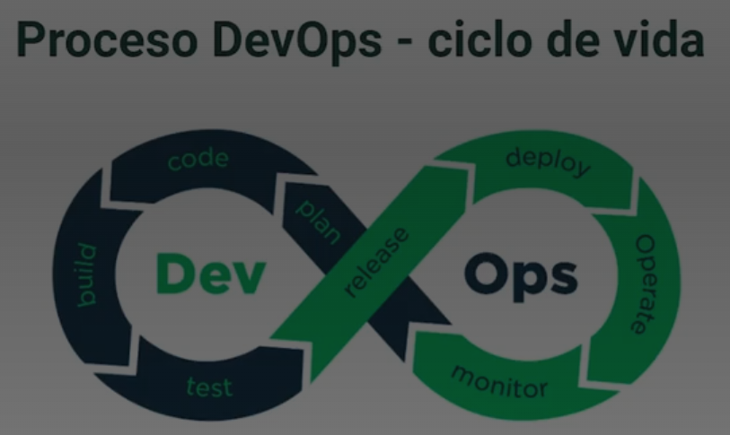
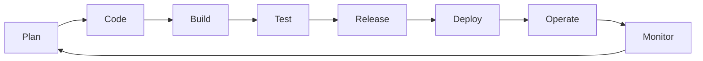
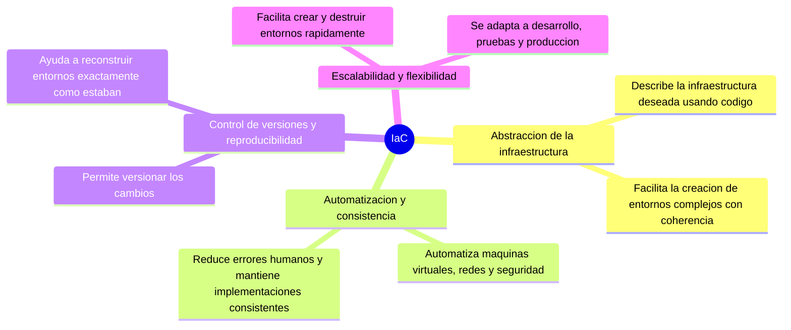
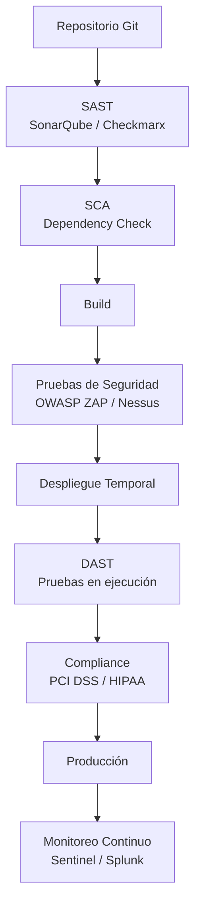

# Notas de clase

## Links cursos
Platzi - Azure Devops
https://platzi.com/cursos/azure-devops/permisos-y-grupos-de-usuarios-en-azure-d/
Diplomado Javeriana
https://educacioncontinua.javerianacali.edu.co/d2l/le/enhancedSequenceViewer/401153?url=https%3A%2F%2F4d08695f-f803-489f-8d3e-2e68a7e386fc.sequences.api.brightspace.com%2F401153%2Factivity%2F3073364%3FfilterOnDatesAndDepth%3D1

## Clase 3/20.

Caracteristicas del DevOps:
* Concepto del 2009.
* Es un concepto de mejora continua que involucra cada uno de los aspectos de TI y procesos de desarrollo.
* Se enfoca en relacionar las personas, los procesos y las herramientas.

Entonces: A partir de una buena definición de proceso y un buen kit de herramientas se realicen soluciones optimas para la mejora de los procesos. 

Hay una relación directa del Agilismo con la cultura DevOps, pues este ultimo es un pilar fundamental para apalancar los despliegues continuos y rapidos.

DevOps no es: 
* Un puesto de trabajo.
* Una herrmaienta.
* Una metodología ágil.
* Una tecnología.
* Un rol.

DevOps es una cultura que converge entre las personas, las herramientas y los procesos.

Herramientas que utilizan esta cultura:
Azure
Jira
gitLab y GitHub (GitHub action)
Jenkins

Entonces DevOps va de la mano con:
* Agilismo.
* Automatización.
* Soporte de infraestructura.
* Integración continua y despliegue continuo.

Grafico resumen del objetivo de automatización del ciclo DevOps:


### Proceso DevOps - ciclo de vida (versión texto)

El diagrama es un símbolo de infinito dividido en dos mitades que representan un ciclo continuo sin fin:

- **Dev** (mitad izquierda, sentido antihorario): `Plan -> Code -> Build -> Test`
- **Release** (punto de cruce entre ambas mitades, pasa de Dev a Ops)
- **Ops** (mitad derecha, sentido horario): `Deploy -> Operate -> Monitor`, y vuelve a cerrar el ciclo hacia `Plan`

Secuencia completa del ciclo/bucle OODA:

```
Plan -> Code -> Build -> Test -> Release -> Deploy -> Operate -> Monitor -> (vuelve a Plan)
```



*Bucle OODA en la práctica:*
- Observe: Supervisión de métricas empresariales, tendencias de mercado, comportamiento del usuario y datos de telemetría.
- Oriente: Analiza opciones para lo que puedes ofrecer, posiblemente a través de experimentos.
- Decidir: determinar qué perseguir en función de los datos y las prioridades empresariales.
- Acto: Entrega de software de trabajo a usuarios reales y recopilación de comentarios.

*Ejercicio de cálculo del tiempo de ciclo:* Piense en el proceso de desarrollo actual. Cuánto tiempo tarda en ir de:
- ¿Confirmación de código → implementación de producción?
- ¿Solicitud de características → comentarios del cliente?
- Informe de errores → ¿Corregir en producción?

*Ejemplo:* Si tardamos 2 semanas en implementar un cambio de configuración de una sola linea. Entonces, el timepo de ciclo es de 2 semanas. Esto se convierte en una restricción de velocidad.

Frase interesante: *Sé informado por los datos, no completamente dirigido por datos.*

Informar para la toma de decisiones y no quedarse estancado en el análisis. Alguna implementaciones seran malas, otras buenas y otras no aportaran nada aparentemente medible. A lo que se refiere esto es que hay que dejarse de tanto pereque, interpretar y ejecutar otro ciclo guiado de: *Fallar rapido en las iniciativas que no avanzan en los objetivos empresariales y redoblar los esfuerzos en los resultados que apalancan los objetico

Link de mucho interés: https://learn.microsoft.com/es-es/azure/devops/get-started/?view=azure-devops

AZURE DevOps:
- Es la suite DevOps de Microsoft.
- Cabe resaltar que Microsoft en dueña de GitHub y son productos complementarios. SOn enfoques distintos.
- Antes Azure DevOps era Visual Studio Online. 
- Cubre todo el proceso de desarrollo.
- Se integra con multicloude (AWS, Azure, GCP).
- Versión: Azure DevOps Server - Esto permite instalar en la propia infraestructura de la empresa los servicios de A. DevOps. Tiene sus limitantes pero a veces esto le conviene a algunas compañias con politicas de seguridad estrictas.


Principales herramientas de Azure DevOps:

* Azure Boards

Herramientas de planeación ágiles

Mantenga un seguimiento del trabajo con paneles kanban, registros de trabajo pendiente interactivos y herramientas de planeamiento muy eficaces. Los informes y la rastreabilidad sin igual convierten a Boards en el lugar perfecto para todas sus ideas, grandes o pequeñas.

----------------------------------------------
* Azure Repos

Repositorios privados gratuitos ilimitados

Consiga un excelente hospedaje GIT, flexible y con revisiones de código muy eficaces, así como repositorios gratuitos ilimitados para todas sus ideas, desde un proyecto de una sola persona hasta el repositorio más grande del mundo.
----------------------------------------------

* Azure Pipelines

CI/CD para cualquier plataforma

Compile, pruebe e implemente soluciones con cualquier lenguaje, en cualquier nube o en el entorno local. Ejecute archivos en paralelo en Linux, macOS y Windows, e implemente contenedores en hosts individuales o en Kubernetes.
----------------------------------------------

* Azure Artifacts

Repositorio de paquetes universal

Comparta paquetes Maven, npm, NuGet y Python de orígenes públicos y privados con todo su equipo. Integre el uso compartido de paquetes en sus canalizaciones de CI/CD de una forma sencilla y escalable.
----------------------------------------------

* Azure Test Plans

Pruebas manuales y exploratorias

Realice pruebas periódicas y publique versiones con confianza. Mejore la calidad global del código con herramientas de pruebas manuales y exploratorias para sus aplicaciones.


#################################
# CONTROL DE VERSIONES
#################################

UTILIZAR HERRAMIENTAS DE OCNTROL DE VERSIONES EN EL DESARROLLO DE SOFTWARE BRINDA BENEFICIOS COMO UN HISTORIAL COMPLETO DE CAMBIOS, FACILIDAD DE COLABORACIÓN, GESTIÓN DE CONFLICTOS Y CAPACIDAD DE ROLLBACK. Por otro lado, no utilizar estas herramientas puede generar problemas como la perdida de cambios, dificultades en la colaboración, falta de seguimiento y trazabilidad, así como el riesgo de pérdida de código. Por lo tanto, es altamente recomendable utilizar herramientas de control de versiones para mejorar la eficiencia y la calidad del desarrollo de software.
Las principales herramientas son:
* GIT: COntrol de versiones distribuida (main+ramas+clones).
* SUBVERSION(SVN): Control de versiones centralizada(main).
* MERCURIAL: Control de versiones distribuida.

#################################
# AUTOMATIZACIÓN DE PRUEBAS Y DESPLIEGUE
#################################
Beneficios de la automatización de pruebas y despliegue de software:

* Eficiencia y ahorro de tiempo: La automatización de pruebas y despliegue de software permite ejecutar pruebas de manera rápida y repetible, lo que ahorra tiempo y recursos. Las pruebas automatizadas se pueden ejecutar automáticamente, lo que reduce la dependencia de las pruebas manuales y permite a los equipos de desarrollo liberar software de manera más rápida y frecuente. 
* Mayor cobertura de pruebas: La automatización de pruebas permite realizar pruebas exhaustivas en diferentes escenarios y configuraciones, lo que ayuda a garantizar una mayor cobertura de pruebas. Esto significa que se pueden identificar y solucionar problemas de manera más efectiva antes de que el software se despliegue en producción. 
* Detección temprana de errores: Al automatizar las pruebas, es posible detectar errores y problemas de manera temprana en el ciclo de desarrollo. Esto permite a los equipos abordar los problemas rápidamente y evitar la propagación de errores a lo largo del proceso de desarrollo, lo que ahorra tiempo y esfuerzo en la resolución de problemas más adelante. 
* Consistencia y confiabilidad: Las pruebas automatizadas aseguran que las pruebas se realicen de manera consistente y confiable. Elimina la posibilidad de errores humanos y garantiza que las pruebas se realicen siguiendo un proceso estandarizado, lo que mejora la calidad del software entregado.

1.2. Problemas asociados con la falta de automatización de pruebas y despliegue:

* Retrasos en el tiempo de entrega: Si las pruebas y el despliegue de software se realizan manualmente, puede llevar mucho tiempo completar estas tareas. Esto puede resultar en retrasos en la entrega del software y afectar la capacidad de respuesta del equipo de desarrollo.
* Errores humanos: Las pruebas manuales están sujetas a errores humanos, ya sea por omisión, falta de atención o inconsistencias en el proceso. Esto puede llevar a la introducción de errores en el software y afectar negativamente su calidad.  
* Falta de cobertura de pruebas adecuada: Las pruebas manuales tienden a ser limitadas en términos de cobertura y pueden pasar por alto ciertos escenarios y configuraciones críticas. Esto puede resultar en la falta de detección de errores importantes y afectar la estabilidad y confiabilidad del software.  
* Mayor costo y esfuerzo: Las pruebas manuales requieren más recursos humanos y tiempo, lo que puede aumentar los costos y la carga de trabajo. Además, la falta de automatización puede generar la necesidad de repetir pruebas en cada ciclo de desarrollo, lo que implica un mayor esfuerzo y consume recursos valiosos.  

En resumen, la automatización de pruebas y despliegue de software brinda beneficios como la eficiencia, el ahorro de tiempo, mayor cobertura de pruebas, detección temprana de errores, consistencia y confiabilidad. Por otro lado, la falta de automatización puede resultar en retrasos en el tiempo de entrega, errores humanos, falta de cobertura de pruebas adecuada y mayor costo y esfuerzo. Por lo tanto, es altamente recomendable automatizar estas tareas para mejorar la eficiencia, la calidad y la entrega de software.

#################################
# HERRAMIENTAS DE INTEGRACIÓN CONTINUA (CI - CONTINUOUS INTEGRATION) Y ENTREGA CONTINUA (CD - CONTINUOUS DELIVERY)
#################################
Las herramientas de integración continua (CI) y entrega continua (CD) ofrecen una serie de beneficios significativos en el desarrollo de software:  

1. Detección temprana de errores: La CI permite la integración automática y regular del código, lo que ayuda a identificar problemas rápidamente, antes de que se conviertan en problemas más grandes.  
2. Entrega más rápida: La automatización en la CD reduce el tiempo entre la escritura del código y su implementación, permitiendo actualizaciones más frecuentes y ágiles.  
3. Mejora en la calidad del software: La ejecución continua de pruebas asegura la calidad del código, lo que reduce la presencia de errores en el producto final.  
4. Facilita la colaboración: La CI fomenta un entorno en el que varios desarrolladores pueden trabajar en el mismo proyecto sin problemas, ya que sus cambios se integran automáticamente.  
5. Mayor eficiencia y productividad: Al automatizar tareas repetitivas como pruebas, compilación y despliegue, los equipos pueden centrarse en tareas más creativas y estratégicas.

Los inconvenientes de no utilizar estas herramientas pueden ser bastante significativos: 
1. Mayor propensión a errores: Sin CI/CD, los errores pueden pasar desapercibidos durante mucho tiempo, lo que resulta en costosos errores de último minuto o en problemas que solo se descubren en etapas avanzadas del desarrollo. 
2. Procesos manuales lentos: Sin automatización, las pruebas, compilaciones y despliegues requieren más tiempo y esfuerzo humano, lo que ralentiza el proceso de desarrollo. 
3. Menor flexibilidad y agilidad: La falta de CI/CD puede hacer que los equipos sean menos ágiles para adaptarse a cambios rápidos o implementar actualizaciones frecuentes, lo que afecta la competitividad y la capacidad de respuesta. 
4. Dificultades en la colaboración: La integración manual del código puede llevar a conflictos entre versiones, dificultando la colaboración entre desarrolladores y generando más trabajo para resolver discrepancias. 

En resumen, la implementación de herramientas de CI/CD ayuda a mejorar la calidad, la velocidad y la eficiencia del desarrollo de software, mientras que la falta de estas herramientas puede resultar en problemas que afectan directamente la calidad del producto final y la eficiencia del equipo de desarrollo.

**Herramientas de Integración Continua (CI):**
1. Jenkins: Es una de las herramientas CI más populares y de código abierto. Permite la integración continua de forma automatizada y es altamente personalizable mediante plugins.
2. Travis CI: Es una plataforma de CI en la nube que se integra fácilmente con repositorios de GitHub. Es conocida por su sencillez de uso y configuración.
3. CircleCI: Ofrece CI/CD en la nube, con soporte para una variedad de lenguajes y frameworks. Proporciona una configuración basada en archivos y una amplia gama de opciones de personalización.
4. GitLab CI/CD: Integrado directamente en GitLab, ofrece un flujo de trabajo de CI/CD que permite a los equipos construir, probar y desplegar proyectos de forma automática. 
5. TeamCity: Ofrece una solución CI potente y fácil de usar, con integración con múltiples herramientas y plataformas.

**Herramientas de Entrega Continua (CD):**
1. Ansible: Automatiza el aprovisionamiento, la configuración y el despliegue de aplicaciones. Se utiliza para orquestar y administrar infraestructuras. 
2. Docker: No es específicamente una herramienta de CD, pero es fundamental para la implementación continua. Proporciona contenedores que simplifican la implementación y portabilidad de aplicaciones.
3. Spinnaker: Diseñada originalmente por Netflix, es una plataforma de CD de código abierto que permite la implementación continua en múltiples nubes.
4. AWS CodePipeline: Es un servicio de AWS que permite orquestar y automatizar la entrega continua de manera sencilla dentro del ecosistema de Amazon Web Services.
5. Google Cloud Build: Herramienta de Google Cloud Platform que permite crear, probar y desplegar aplicaciones de forma automática en la nube.
6. Microsoft Azure Pipeline: es la solución de Microsoft integrada a su plataforma de gestión de equipos Azure, funciona de forma similar al pipeline de AWS. 

Estas herramientas son solo algunas de las disponibles, y su elección dependerá de las necesidades específicas del proyecto, la infraestructura utilizada y las preferencias del equipo de desarrollo.

#################################
# INFRAESTRUCTURA COMO CÓDIGO (IaC) Y HERRAMIENTAS
#################################
La infraestructura como código (IaC) es una metodología que consiste en manejar y gestionar la infraestructura de sistemas informáticos utilizando código, en lugar de configuraciones manuales o procesos interactivos. Básicamente, es aplicar los principios de desarrollo de software al manejo de la infraestructura.
En lugar de configurar servidores, redes o cualquier otro componente de la infraestructura de manera manual, se utiliza código para definir y automatizar estos recursos. Esto se logra mediante el uso de lenguajes de programación específicos o herramientas diseñadas para este propósito, como Terraform, AWS CloudFormation, Ansible o Chef, entre otros. 

**Aspectos relevantes.**


Resumen:
- **Abstraccion de la infraestructura:** permite describir la infraestructura deseada utilizando codigo.
- **Automatizacion y consistencia:** ayuda a automatizar tareas repetitivas y evita errores humanos.
- **Control de versiones y reproducibilidad:** permite rastrear cambios y reconstruir entornos con precision.
- **Escalabilidad y flexibilidad:** facilita ajustar la infraestructura segun las necesidades del proyecto.

La infraestructura como código es una práctica que utiliza código para definir, configurar y administrar la infraestructura de manera automatizada y escalable, mejorando la eficiencia, la consistencia y la agilidad en el despliegue y gestión de sistemas informáticos. 

**Cuando no se utiliza IaC, pueden surgir varios problemas:**
1. Inconsistencia: La infraestructura manual tiende a ser inconsistente, ya que las configuraciones pueden variar entre diferentes entornos (desarrollo, pruebas, producción). Esto puede provocar errores inesperados y dificultar la replicación de entornos. 
2. Dificultad en la gestión: Gestionar manualmente la infraestructura es más propenso a errores y más lento en términos de implementación y cambios. Esto puede causar problemas de tiempo de inactividad y retrasos en la entrega. 
3. Falta de trazabilidad y documentación: Sin IaC, es más difícil mantener un registro claro de los cambios en la infraestructura y entender cómo se configuró un entorno en particular. Esto puede complicar la resolución de problemas y la colaboración entre equipos. 
4. Mayor riesgo de errores humanos: La configuración manual aumenta la posibilidad de cometer errores durante la implementación o la actualización de la infraestructura, lo que puede tener repercusiones costosas en términos de tiempo y recursos.

En resumen, adoptar prácticas de infraestructura como código proporciona consistencia, agilidad y eficiencia en el desarrollo y gestión de la infraestructura, mientras que la falta de uso puede llevar a problemas de consistencia, errores humanos y dificultades en la gestión y mantenimiento.

Existen varias herramientas de infraestructura como código, cada una con sus fortalezas y casos de uso específicos. Aquí te presento algunas de las principales:
1. Terraform: Es una herramienta ampliamente utilizada y agnóstica de proveedor, lo que significa que puedes usarla para gestionar recursos en múltiples plataformas (AWS, Azure, Google Cloud, entre otros). Es ideal cuando se requiere trabajar con entornos heterogéneos o migrar entre proveedores en el futuro. Terraform utiliza archivos de configuración declarativos (llamados archivos HCL) para describir la infraestructura.
2. AWS CloudFormation: Es específica de Amazon Web Services (AWS) y se utiliza para definir y desplegar recursos en la nube de AWS. Si te enfocas exclusivamente en AWS, CloudFormation puede ser una elección sólida, ya que está integrada completamente en el ecosistema de AWS. 
3. Azure Resource Manager (ARM) Templates: Similar a CloudFormation pero para Microsoft Azure. Permite describir y desplegar recursos en Azure utilizando archivos de plantilla JSON. Si trabajas principalmente en Azure, esta puede ser la opción más natural.
4. Ansible: Aunque es conocida principalmente como una herramienta de automatización de configuración, Ansible también se puede utilizar para manejar la infraestructura como código. Es agente-less y utiliza YAML para describir configuraciones. Es particularmente útil para la configuración de software y el despliegue en múltiples nodos. 
5. Chef y Puppet: Estas herramientas se centran más en la configuración y gestión de la infraestructura en sistemas y servidores. Son excelentes para configuraciones complejas y gestionar el estado deseado de los sistemas a lo largo del tiempo.


**La elección de la herramienta depende de varios factores:**
*  Entorno de nube específico: Si estás comprometido con un proveedor de nube específico, como AWS o Azure, su herramienta nativa (CloudFormation o ARM) puede ser la mejor opción debido a su integración y compatibilidad. 
* Requerimientos de multi-cloud o portabilidad: Si necesitas trabajar en múltiples nubes o mantener la capacidad de cambiar fácilmente entre proveedores, Terraform puede ser más adecuada debido a su agnosticismo de proveedor.
* Habilidades y preferencias del equipo: La experiencia del equipo en una herramienta específica puede influir en la elección. Es posible que un equipo que ya esté familiarizado con Ansible, Chef o Puppet prefiera seguir utilizando esas herramientas.

En última instancia, la mejor herramienta depende de las necesidades específicas del proyecto, el entorno de implementación y las habilidades del equipo.

#################################
# VISUAL STREAM MAPPING
#################################
1. Gestión del flujo de valor en un entorno ágil
Muchas organizaciones enfrentan obstaculos para alacanzar los resultados prometidos por Agile, y un obstaculo común son los *silos organizativos*.

¿Qué es la gestión del flujo de valor?
Es una *solución sistemática* para comprender y mejorar el **flujo de valor empresarial**. Desde la solicitud del cliente hasta la entrega de valor. Este enfoque va más allá del compromiso tradicional y busca **impulsar la mejora continua y generar más valor para el cliente** (Jeff Rosenbaugh).

El flujo de valor es: La secuencia de pasos que agregan valor para el cliente.Enotnces, se trata de optimizar los desperdicios y optimizar el proceso basado en ese flujo. Desde una perspectiva ágil el flujo de valor permite:
* Priorizar resultados sobre la producción de funciones. Escencal para cerrar la brecha entre prácticas ágiles y la verdadera promesa de valor. 

En mis palabras. Uno puede ágilizar tambien tareas que no generan nada, tareas basura. Por tanto, entender el flujo de valor es crucial, para priorizar aquellas actividades que le dan valor al cliente y 
por tanto tienen un ROI (sea economico, temporal, de lobby) mucho más palpable que otras actividades.

2. Beneficios de la gestión del flujo de valor.
flowchart TD
    A["Aceleración del tiempo<br/>de obtención de valor"] --> B["Alineación de equipos<br/>multifuncionales"]
    B --> C["Medición clara del<br/>desempeño del sistema"]
    C --> D["Inversiones basadas<br/>en datos"]
    D --> E["Eliminación de desperdicios<br/>y mejora de la efectividad"]
    E --> A

* Aceleración del tiempo para obtener valor: Al enfocarse en el flujo completo, naturalmente se obtiene valor de forma más rapida.
* Alineación de equipos multifuncionales: Objetivos comunes, priorización de tareas criticas y eliminación de duplicidad.
* Medición clara del desempeño del sistema: Al medir proporciona una visual/comprensión transparente de los flujos de valor permitiendouna medición mas acertiva.
* Permite presupuestar los flujos completos y no segmentado por poryectos.
* Eliminación de desperdicios y mejora de la efectividad: Porque al levantar el flujo, se detecta y se eliminan desperdicios del ciclo, esto aumenta la eficiencia y reduce la sobrecarga de los equipos.

3. Errores comunes en la gestión del flujo de valor.
A pesar de sus beneficios, las organizaciones pueden resistirse a adoptar la gestión del flujo de valor debido a:
* *Alterar el Statu Quo:* El cambio puede revelar prioridades desalineadas e ineficiencias, lo que algunas organizaciones prefieren evitar.
* *Sesgo de sofisticación:* La percepción de que la gestión del flujo de valor es demasiado simple o que requiere inversiones costosas puede ser un obstáculo.
* *Entornos laborales cambiantes:* La transición a entornos de trabajo híbridos y remotos requiere adaptaciones en la forma en que se mapean y gestionan los flujos de valor.

4. ¿Qué medir en los flujos de valor?
* **Tasa de entrega de valor (Flow Velocity):** cantidad de elementos de flujo completados en un periodo determinado. Su objetivo es medir cuánto valor logra terminar el sistema en una ventana de tiempo dada.
* **Tiempo de flujo (Flow Time):** tiempo total que tarda un elemento de flujo desde que inicia el trabajo hasta que se completa, incluyendo tanto tiempo activo como tiempo de espera. Sirve para evaluar la velocidad real de entrega.
* **Carga de flujo (Flow Load):** número de elementos de flujo que se encuentran en progreso al mismo tiempo dentro del flujo de valor. Ayuda a detectar sobrecarga, exceso de trabajo en curso y cuellos de botella.
* **Distribución del flujo (Flow Distribution):** proporción de los distintos tipos de trabajo completados en un periodo, por ejemplo funcionalidades, defectos, deuda técnica o riesgos. Permite entender en qué se está consumiendo la capacidad del equipo.

Estas métricas se correlacionan con resultados comerciales deseados, conectando el trabajo con el impacto al cliente, el negocio y los ingresos.

5. KPIs adicionales útiles en este contexto.
* **Eficiencia de flujo (Flow Efficiency):** porcentaje del tiempo total en que un elemento realmente estuvo siendo trabajado frente al tiempo que permaneció esperando. Es útil para identificar desperdicio dentro del proceso.
* **Frecuencia de despliegue:** número de despliegues a producción realizados en un periodo determinado. Permite medir la capacidad del pipeline para entregar cambios de forma continua.
* **Tasa de fallos por cambio (Change Failure Rate):** porcentaje de despliegues o cambios que generan incidentes, rollback o degradación del servicio. Complementa la velocidad con una visión de estabilidad.
* **Tiempo medio de recuperación (MTTR):** tiempo promedio necesario para restaurar el servicio después de una falla en producción. Indica la resiliencia operativa del flujo.
* **Predictibilidad de entrega:** porcentaje de compromisos cumplidos frente a lo planificado para una iteración, sprint o periodo de entrega. Es clave para saber si el flujo produce resultados confiables para el negocio.

6. Herramientas para la gestión del flujo de valor.
* **Lucidchart:** herramienta de diagramación que interviene en la etapa de modelado del flujo. Sirve para mapear el flujo de valor, visualizar etapas, actores, dependencias, cuellos de botella y puntos de espera.
* **Miro:** pizarra colaborativa que interviene en la construcción colectiva del flujo. Ayuda a talleres de descubrimiento, identificación de desperdicios, priorización de mejoras y alineación entre negocio, desarrollo y operaciones.
* **Jira:** herramienta de gestión del trabajo que interviene en la ejecución y seguimiento del flujo. Permite visualizar backlog, trabajo en curso, estados, tiempos de ciclo y bloqueos sobre cada ítem de valor.
* **Azure DevOps:** plataforma que interviene en la trazabilidad del flujo desde la demanda hasta la entrega. Integra tableros, repositorios, pipelines y despliegues para seguir cómo una necesidad del cliente avanza hasta producción.
* **Planview Viz:** herramienta especializada en value stream management que interviene en la medición integral del flujo. Consolida datos de distintas herramientas para calcular métricas como Flow Velocity, Flow Time, Flow Load y Flow Distribution.

7. Consejos para la implementación.

La implementación de la gestión del flujo de valor no debería abordarse como una actividad aislada, sino como una práctica continua de observación, medición y mejora. Una forma útil de hacerlo es seguir estos pasos:

* **1. Comenzar de forma sencilla:** el primer esfuerzo debe centrarse en visualizar el flujo actual sin intentar optimizar todo al mismo tiempo. Lo recomendable es seleccionar un flujo concreto, por ejemplo desde que se solicita un cambio hasta que se despliega en producción, y mapear solo sus etapas principales. Aquí son útiles metodologías como **Lean**, porque ayudan a identificar desperdicio, y **Kanban**, porque permite visualizar el trabajo en curso y limitarlo. Un ejemplo sería iniciar con un tablero simple de cinco estados: solicitud, análisis, desarrollo, pruebas y despliegue. Esto da una primera fotografía real del sistema antes de introducir más detalle.

* **2. Aplicar mapeo inverso:** en lugar de comenzar describiendo tareas internas, conviene partir del resultado que espera el cliente o el negocio y retroceder hasta encontrar qué actividades permiten alcanzarlo. Esta lógica es propia del **Value Stream Mapping (VSM)** y también se alinea con enfoques de **product thinking**, donde primero se define el valor entregado. Por ejemplo, si la meta es reducir el tiempo para publicar una mejora crítica, se puede empezar desde la liberación en producción y retroceder hacia pruebas, desarrollo, análisis, aprobación y solicitud original. Esto ayuda a diferenciar pasos que agregan valor de pasos que solo agregan espera o burocracia.

* **3. Abrazar el aprendizaje continuo:** ningún flujo queda bien definido desde el primer intento. La organización necesita revisar datos, detectar patrones y ajustar tanto el proceso como los roles involucrados. Aquí encajan muy bien **Kaizen**, **retrospectivas ágiles** y el ciclo **PDCA (Plan-Do-Check-Act)**, porque convierten la mejora en una disciplina recurrente. Un ejemplo práctico sería revisar cada dos semanas el tiempo de flujo y la carga de flujo para detectar si las aprobaciones están retrasando la entrega. Si el cuello de botella aparece siempre en el mismo punto, el aprendizaje debe traducirse en un cambio concreto del proceso.

* **4. Mantener un documento vivo:** el mapa del flujo, sus políticas y sus métricas deben actualizarse conforme cambia la realidad operativa. No sirve documentar una vez y archivar, porque el flujo evoluciona con nuevas herramientas, nuevas dependencias y nuevas formas de trabajo. Este principio puede apoyarse en prácticas de **gestión del conocimiento**, **documentación continua** y **gobernanza ligera de procesos**. Un ejemplo sería mantener en Confluence, Notion o una wiki interna un mapa del flujo con responsables, criterios de entrada y salida por etapa, métricas observadas y mejoras pendientes. Así, el documento deja de ser descriptivo y se convierte en una herramienta de gestión.

* **5. Preguntar por qué de manera sistemática:** cuando aparece un retraso, retrabajo o falla, no conviene quedarse en la explicación superficial. La técnica de los **Cinco Porqués** permite profundizar hasta llegar a causas raíz, y puede complementarse con **Ishikawa** o análisis de causa raíz. Por ejemplo, si una entrega se retrasa, la primera respuesta puede ser "faltaron pruebas"; al seguir preguntando por qué, puede descubrirse que no había ambientes disponibles, que la automatización era insuficiente o que la definición de terminado era ambigua. La intervención correcta cambia por completo cuando se entiende la causa raíz real.

En conjunto, estos pasos permiten implementar la gestión del flujo de valor de manera progresiva y con foco en resultados. La clave no es mapear por mapear, sino usar el mapa, las métricas y el aprendizaje para tomar decisiones que reduzcan tiempos, eliminen desperdicios y aumenten la entrega de valor.

#################################
# SEGURIDAD EN DevOps
#################################
## 1. Automatización de pruebas de seguridad

### Concepto
La automatización de pruebas de seguridad busca incorporar controles de seguridad directamente en los pipelines CI/CD para detectar vulnerabilidades de forma temprana. OWASP destaca que DevSecOps incorpora actividades como SAST, DAST, IAST, análisis de dependencias (SCA) y escaneo de infraestructura dentro del ciclo de entrega continua. [Fuente: OWASP DevSecOps Guideline]

### Ejemplos concretos
- Ejecutar SonarQube o CodeQL en cada Pull Request.
- Escanear dependencias con Dependabot o Snyk.
- Ejecutar OWASP ZAP automáticamente antes de promover una versión a producción.
- Analizar imágenes Docker en busca de vulnerabilidades antes de publicarlas.

### Caso real
Log4Shell (2021) afectó millones de sistemas debido a una vulnerabilidad en Log4j. Las organizaciones con procesos automatizados de escaneo de dependencias pudieron identificar los sistemas afectados mucho más rápido.

### Lecturas recomendadas
- https://owasp.org/projects/devsecops-guideline
- https://devguide.owasp.org/en/09-operations/01-devsecops/
- https://learn.microsoft.com/es-es/training/modules/introduction-to-secure-devops/

### Cursos
- Microsoft Learn: Introducción a Secure DevOps
- Coursera: Introduction to DevSecOps

---

## 2. Gestión de configuración segura

### Concepto
Consiste en asegurar que servidores, aplicaciones, contenedores y servicios mantengan configuraciones seguras y consistentes.

### Ejemplos
- Deshabilitar servicios innecesarios.
- Utilizar Infrastructure as Code (Terraform, Bicep).
- Gestionar secretos mediante Azure Key Vault o Hashicorp Vault.
- Implementar políticas automáticas de configuración en Kubernetes.

### Caso real
Numerosas brechas en AWS han ocurrido debido a buckets S3 configurados erróneamente y expuestos públicamente.

### Lecturas
- OWASP DevSecOps Guideline
- Azure DevSecOps

---

## 3. Monitoreo y detección temprana

### Concepto
La seguridad no termina con el despliegue. Debe existir monitoreo continuo para detectar actividad sospechosa.

### Ejemplos
- Microsoft Sentinel para correlación de eventos.
- Detección de accesos anómalos.
- Alertas sobre escalamiento de privilegios.
- Detección de ejecución de código sospechoso.

### Caso real
El ataque a SolarWinds mostró la importancia de monitorear continuamente tanto el pipeline como los entornos productivos.

---

## 4. Segmentación y control de acceso

### Concepto
NIST define Zero Trust como un paradigma donde ningún usuario o dispositivo recibe confianza implícita solamente por su ubicación en la red.

### Ejemplos
- MFA obligatorio.
- Acceso Just-In-Time para administradores.
- Separación de ambientes Desarrollo, QA y Producción.
- Microsegmentación de redes.

### Caso de uso
Un desarrollador puede acceder al repositorio Git, pero no a la base de datos productiva.

### Lecturas
- NIST SP 800-207 Zero Trust Architecture.
- Microsoft Zero Trust.

---

## 5. Gestión de vulnerabilidades

### Concepto
Proceso continuo de identificación, clasificación, priorización y remediación de vulnerabilidades.

### Ejemplos
- Escaneo semanal con Nessus.
- Clasificación según CVSS.
- Parcheo automatizado de sistemas.

### Caso real
La vulnerabilidad Log4Shell mostró la necesidad de inventarios de software actualizados y escaneo permanente.

---

## 6. Educación y concienciación

### Concepto
La seguridad efectiva requiere una cultura organizacional en la que desarrolladores, operadores y responsables de negocio conozcan los riesgos de seguridad.

### Ejemplos
- Simulaciones de phishing.
- Laboratorios OWASP Juice Shop.
- Talleres de Secure Coding.

### Recurso recomendado
OWASP WebGoat y OWASP Juice Shop.

---

## 7. Principio de responsabilidad compartida

### Concepto
DevSecOps promueve que la seguridad sea responsabilidad de todos los equipos y no exclusivamente del área de seguridad.

Microsoft indica que DevSecOps convierte la seguridad en una responsabilidad compartida respaldada por automatización, validaciones continuas y políticas integradas al ciclo de desarrollo.

### Ejemplo
- Desarrollo corrige vulnerabilidades.
- Operaciones protege infraestructura.
- Seguridad define controles y monitorea riesgos.

---

## 8. Evaluación y mejora continua

### Concepto
OWASP SAMM proporciona un modelo de madurez para evaluar y mejorar continuamente la postura de seguridad del desarrollo de software.

### Ejemplos de métricas
- Tiempo promedio de remediación.
- Porcentaje de cobertura SAST.
- Vulnerabilidades críticas abiertas.
- Cobertura de MFA.

### Lecturas
- https://owasp.org/projects/samm
- https://owaspsamm.org/

# Integración de seguridad en pipelines CI/CD: aportes del video

El video aterriza los conceptos generales de DevSecOps a controles concretos que pueden incorporarse en un pipeline de Integración Continua y Despliegue Continuo (CI/CD). Mientras el material del módulo explica la importancia de la automatización de pruebas de seguridad y la gestión de identidades y accesos (IAM), el video detalla qué controles específicos deben automatizarse y en qué momento del pipeline aplicarlos.

1. Análisis Estático de Código (SAST)
¿Qué es?

El análisis estático de seguridad (Static Application Security Testing - SAST) consiste en revisar el código fuente sin necesidad de ejecutar la aplicación. El objetivo es detectar vulnerabilidades, errores de programación y malas prácticas antes de que el código sea integrado al repositorio principal.

Hallazgos típicos
Credenciales hardcodeadas.
Inyecciones SQL.
Validaciones insuficientes de entrada.
Uso inseguro de criptografía.
Exposición de información sensible.
Herramientas mencionadas en el video
SonarQube
ESLint
Checkmarx
Ejemplo práctico

Supongamos que un desarrollador introduce el siguiente código:

query = "SELECT * FROM usuarios WHERE id = " + user_input


Una herramienta SAST detectaría que el código es vulnerable a SQL Injection incluso antes de ejecutar la aplicación.

Caso real

La vulnerabilidad SQL Injection continúa formando parte de las categorías más frecuentes identificadas por OWASP en aplicaciones web empresariales.

Lecturas recomendadas
OWASP Code Review Guide
https://docs.sonarsource.com/

2. Escaneo de Dependencias (SCA)
¿Qué es?

El análisis de composición de software (Software Composition Analysis - SCA) busca identificar vulnerabilidades en bibliotecas de terceros utilizadas por la aplicación.

Actualmente la mayoría de los proyectos modernos contienen más código de terceros que código propio, lo que convierte esta práctica en una de las más importantes del pipeline.

Herramienta mencionada
OWASP Dependency Check
Ejemplo práctico

Si una aplicación utiliza:

log4j 2.14.1


un escaneo SCA identificaría la vulnerabilidad Log4Shell y bloquearía su despliegue hasta actualizarla.

Caso real

Log4Shell (CVE-2021-44228) afectó millones de sistemas en todo el mundo porque la librería vulnerable estaba presente en innumerables aplicaciones empresariales.

Recursos
OWASP Dependency Check
https://nvd.nist.gov/

3. Pruebas Automáticas de Seguridad
¿Qué son?

Son pruebas integradas al pipeline que validan automáticamente la aplicación y la infraestructura buscando vulnerabilidades conocidas.

Vulnerabilidades mencionadas en el video
SQL Injection
Cross-Site Scripting (XSS)
Configuraciones inseguras
Herramientas mencionadas
OWASP ZAP
Nessus
Ejemplo práctico

Después de desplegar una aplicación en un entorno temporal:

Build
 ↓
Deploy temporal
 ↓
OWASP ZAP Scan
 ↓
Promover a Producción


Si se detecta un formulario vulnerable a XSS, el pipeline falla automáticamente.

Beneficios
Retroalimentación inmediata para el desarrollador.
Menor costo de corrección.
Menos vulnerabilidades en producción.

4. Análisis Dinámico de Seguridad (DAST)
¿Qué es?

A diferencia del SAST, el análisis dinámico (Dynamic Application Security Testing - DAST) evalúa la aplicación mientras está ejecutándose.

Qué detecta
Errores de autenticación.
Configuraciones inseguras.
Exposición de APIs.
Fallos en sesiones.
Vulnerabilidades explotables en tiempo de ejecución.
Ejemplo práctico

Un escáner DAST revisa una aplicación desplegada e identifica que:

/api/clientes


permite acceder a información sin autenticación adecuada.

| Característica | SAST (Static Application Security Testing) | DAST (Dynamic Application Security Testing) |
|----------------|--------------------------------------------|---------------------------------------------|
| Momento de ejecución | Durante el desarrollo | Después del despliegue |
| Objeto analizado | Código fuente | Aplicación en ejecución |
| Requiere aplicación desplegada | No | Sí |
| Detecta | Errores de programación, malas prácticas y vulnerabilidades en el código | Fallos explotables en tiempo de ejecución y configuraciones inseguras |
| Velocidad | Generalmente más rápido | Generalmente más lento |
| Ventaja principal | Identifica problemas tempranamente | Simula escenarios más cercanos a un ataque real |
| Ejemplos de herramientas | SonarQube, Checkmarx, CodeQL | OWASP ZAP, Burp Suite, Nessus |

5. Verificación de Cumplimiento
¿Qué es?

El video enfatiza que los pipelines pueden validar automáticamente requisitos regulatorios y políticas internas.

Marcos normativos mencionados
PCI DSS
HIPAA
Ejemplos
PCI DSS

En sistemas que procesan tarjetas de crédito:

Cifrado obligatorio.
Registro de eventos.
Restricción de privilegios.
HIPAA

En sistemas de salud:

Protección de información médica.
Control de accesos.
Auditoría de actividades.
Beneficio

El cumplimiento deja de ser una auditoría puntual y pasa a evaluarse continuamente.

6. Automatización de Parches y Actualizaciones
¿Qué es?

El video destaca la importancia de automatizar la aplicación de parches de seguridad.

Ejemplo

Pipeline:

Nueva imagen Docker
    ↓
Escaneo de vulnerabilidades
    ↓
Actualización automática
    ↓
Pruebas
    ↓
Despliegue

Beneficios
Reduce ventanas de exposición.
Disminuye errores manuales.
Mejora tiempos de remediación.
Caso real

Muchas organizaciones afectadas por ransomware habían postergado actualizaciones críticas que ya contaban con parches disponibles.

7. Monitoreo Continuo
¿Qué es?

El video resalta que la seguridad debe extenderse a:

Desarrollo
Pruebas
Producción
Capacidades recomendadas
SIEM
Alertas automáticas
Detección de anomalías
Correlación de eventos
Herramientas recomendadas
Microsoft Sentinel
Splunk
Elastic Security
Caso de uso

Detectar:

Usuario de Desarrollo
↓
Acceso inusual a Producción
↓
Alerta automática
↓
Respuesta inmediata

Arquitectura DevSecOps sugerida



Conclusiones clave del video

Los conceptos nuevos o ampliados respecto al material original son:

Diferenciación clara entre SAST y DAST.
Importancia específica del escaneo de dependencias (SCA).
Incorporación de validaciones de cumplimiento normativo dentro del pipeline.
Automatización de parches y actualizaciones de seguridad.
Seguridad entendida como una cadena continua desde el desarrollo hasta producción.
Herramientas concretas para implementar DevSecOps: SonarQube, ESLint, Checkmarx, OWASP Dependency Check, OWASP ZAP y Nessus.
Necesidad de automatizar al máximo los controles para detectar problemas tempranamente y reducir riesgos durante el despliegue.

Todo esto complementa directamente el contenido base del módulo sobre automatización de pruebas de seguridad, IAM e integración de la seguridad a lo largo del ciclo de vida del desarrollo descrito en ScreenshotsDeSeguridad.docx>.

# Fuentes

1. OWASP DevSecOps Guideline: https://owasp.org/projects/devsecops-guideline
2. OWASP Developer Guide - DevSecOps: https://devguide.owasp.org/en/09-operations/01-devsecops/
3. Microsoft Learn - Introducción a Secure DevOps: https://learn.microsoft.com/es-es/training/modules/introduction-to-secure-devops/
4. Microsoft Security - What is DevSecOps: https://www.microsoft.com/es-es/security/business/security-101/what-is-devsecops
5. NIST SP 800-207 Zero Trust Architecture: https://csrc.nist.gov/pubs/sp/800/207/final
6. OWASP SAMM: https://owasp.org/projects/samm
7. OWASP SAMM Model: https://owaspsamm.org/
