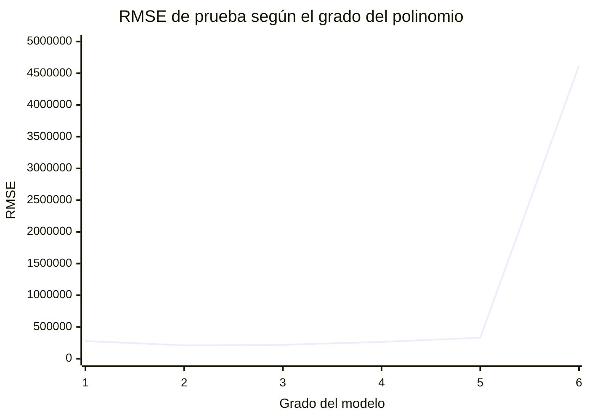

# Regresión polinomial

## Objetivos de aprendizaje

Al terminar estas notas podrás:

- Explicar cómo una regresión lineal puede representar relaciones curvas mediante una transformación polinomial.
- Reconocer el papel de los términos de interacción entre predictores.
- Identificar el efecto del grado sobre la cantidad de parámetros y el riesgo de sobreajuste.
- Construir y evaluar un flujo de trabajo de regresión polinomial con Python y scikit-learn.
- Usar regularización y validación para elegir un modelo que generalice.

## 1. ¿Cuándo usar regresión polinomial?

La regresión lineal modela la relación entre una variable objetivo \(y\) y uno o más predictores \(x\) como una suma ponderada. Si la relación real es curva, una recta puede resultar demasiado simple. La regresión polinomial permite representar esa curvatura al añadir potencias de los predictores.

Por ejemplo, una relación entre antigüedad de un vehículo y su precio podría disminuir rápidamente al principio y más lentamente después. Una recta no necesariamente captura ese patrón; un polinomio de grado 2 sí puede representar una curva.

> **Idea clave:** la forma de la relación con los datos puede ser no lineal, pero el modelo sigue siendo lineal respecto de sus coeficientes. Por eso se puede estimar con métodos de regresión lineal después de transformar las variables.

### Preguntas orientadoras

- ¿Qué patrón muestran los datos: aproximadamente recto, curvo o con cambios de tendencia?
- ¿Hay suficientes observaciones en todo el rango del predictor para estimar la curva con confianza?
- ¿La curva tiene sentido para el problema de negocio o solo sigue fluctuaciones del conjunto de entrenamiento?

## 2. Cómo funciona la transformación

Con un predictor \(x\), un polinomio de grado \(p\) se expresa como:

\[
\hat{y} = w_0 + w_1x + w_2x^2 + \dots + w_px^p
\]

Para grado 2 se añaden \(x^2\); para grado 3 se añaden \(x^2\) y \(x^3\). Los coeficientes \(w_0,\dots,w_p\) se ajustan a los datos igual que en una regresión lineal.

Con dos predictores \(x_1\) y \(x_2\), una expansión de grado 2 (incluyendo términos de grado menor) produce:

\[
\hat{y} = w_0 + w_1x_1 + w_2x_2 + w_3x_1^2 + w_4x_1x_2 + w_5x_2^2
\]

El término \(x_1x_2\) representa una **interacción**: el efecto de un predictor puede depender del valor del otro. Por ejemplo, el efecto de la antigüedad de un vehículo sobre el precio podría variar según su kilometraje.

La transformación polinomial es una técnica de **ingeniería de características**: crea representaciones nuevas a partir de las variables disponibles para que el modelo pueda aprender patrones más ricos.

### Crecimiento del número de características

Con \(d\) predictores y polinomios de grado máximo \(p\), el número de términos, sin contar el sesgo, es:

\[
\binom{d+p}{p} - 1
\]

Este crecimiento puede ser rápido. Por ello, aumentar el grado incrementa la flexibilidad, pero también el costo computacional y el riesgo de sobreajuste.

### Preguntas orientadoras

- ¿Qué términos nuevos crea una expansión de grado 2 para dos predictores?
- ¿Tiene sentido incluir interacciones para el fenómeno que se quiere explicar?
- ¿Cuántas características tendrá la expansión antes de entrenarla?

## 3. Ejemplo práctico: aproximar una relación curva

El siguiente ejemplo genera datos sintéticos con una tendencia cuadrática y ruido. Compara una recta con un modelo polinomial de grado 2 en un conjunto de prueba.

```python
import numpy as np
from sklearn.linear_model import LinearRegression
from sklearn.metrics import mean_squared_error
from sklearn.model_selection import train_test_split
from sklearn.pipeline import make_pipeline
from sklearn.preprocessing import PolynomialFeatures, StandardScaler

rng = np.random.default_rng(42)
X = np.linspace(-3, 3, 120).reshape(-1, 1)
y = 2 + 1.5 * X[:, 0] + 2 * X[:, 0] ** 2
y += rng.normal(0, 2, size=X.shape[0])

X_train, X_test, y_train, y_test = train_test_split(
    X, y, test_size=0.25, random_state=42
)

modelos = {
    "Lineal": make_pipeline(StandardScaler(), LinearRegression()),
    "Polinomial grado 2": make_pipeline(
        StandardScaler(),
        PolynomialFeatures(degree=2, include_bias=False),
        LinearRegression(),
    ),
}

for nombre, modelo in modelos.items():
    modelo.fit(X_train, y_train)
    predicciones = modelo.predict(X_test)
    rmse = np.sqrt(mean_squared_error(y_test, predicciones))
    print(f"{nombre}: RMSE = {rmse:.2f}")
```

La escala de las variables se ajusta dentro del flujo de trabajo. Así, el escalador se entrena solo con los datos de entrenamiento y no obtiene información del conjunto de prueba. En este ejemplo, la curva cuadrática que generó los datos es un patrón conocido; en un caso real, la forma se debe inferir y validar con datos separados.

Para visualizar los resultados, se puede ordenar el conjunto de prueba y graficar sus valores reales junto con las predicciones:

```python
import matplotlib.pyplot as plt

orden = np.argsort(X_test[:, 0])
modelo = modelos["Polinomial grado 2"]
predicciones = modelo.predict(X_test)

plt.scatter(X_test[:, 0], y_test, label="Datos de prueba", alpha=0.7)
plt.plot(
    X_test[orden, 0],
    predicciones[orden],
    color="crimson",
    label="Predicción polinomial",
)
plt.xlabel("x")
plt.ylabel("y")
plt.title("Ajuste de una regresión polinomial de grado 2")
plt.legend()
plt.tight_layout()
plt.show()
```

## 4. Complejidad, generalización y sobreajuste

La complejidad del modelo aumenta con el número de parámetros que debe aprender. Al incrementar el grado, la curva puede adaptarse mejor a los datos de entrenamiento, pero también puede empezar a seguir el ruido. A esto se le llama **sobreajuste**: el rendimiento en entrenamiento es bueno, pero el modelo predice peor para observaciones nuevas.

Las notas originales incluyen este ejemplo de predicción de ventas de vehículos. La cantidad de variables y el RMSE de prueba reportados muestran que el grado 2 fue el mejor de los grados comparados. Un RMSE menor indica, en promedio, errores de predicción menores, en las mismas unidades de la variable objetivo.

| Modelo | Cantidad de variables reportada | RMSE en prueba |
|---|---:|---:|
| Regresión lineal | 13 | 278 458.18 |
| Polinomial, grado 2 | 105 | 210 850.68 |
| Polinomial, grado 3 | 560 | 218 964.68 |
| Polinomial, grado 4 | 2 380 | 265 285.78 |
| Polinomial, grado 5 | 8 568 | 330 713.33 |
| Polinomial, grado 6 | 27 132 | 4 615 794.01 |



El patrón ilustra el equilibrio entre **sesgo** y **varianza**:

- Un modelo demasiado simple puede no capturar la estructura de los datos (sesgo alto).
- Un modelo demasiado complejo puede aprender ruido y generalizar mal (varianza alta).
- El objetivo es elegir complejidad suficiente para representar el patrón, sin añadir complejidad innecesaria.

Esto se relaciona con la **navaja de Ockham**: entre modelos con desempeño adecuado, conviene preferir el más sencillo. El grado 2 de la tabla obtiene el RMSE de prueba más bajo; los grados mayores no mejoran ese resultado.

> Los valores de la tabla son resultados del ejemplo incluido en las notas fuente; no son una garantía de que esos grados tengan el mismo desempeño en otros datos.

### Preguntas orientadoras

- ¿Qué modelo tiene el menor error en prueba?
- ¿Qué ocurre con el error al pasar de grado 2 a grados mayores?
- Si el error de entrenamiento baja al subir el grado, ¿significa necesariamente que el modelo mejoró?
- ¿Qué consecuencias tendría para el negocio una predicción con un error de ese tamaño?

## 5. Regularización: controlar coeficientes grandes

La regularización añade una penalización al objetivo de entrenamiento para evitar coeficientes excesivamente grandes. Puede ser útil cuando la expansión polinomial crea muchas características correlacionadas.

- **Ridge (L2):** penaliza la suma de los cuadrados de los coeficientes. Reduce su magnitud y suele conservar todas las características.
- **Lasso (L1):** penaliza la suma de los valores absolutos. Puede llevar algunos coeficientes a cero, funcionando también como selección de características.

El parámetro `alpha` controla la intensidad de la penalización: un valor mayor aplica una regularización más fuerte. Debe elegirse mediante validación, no usando el conjunto de prueba.

### Ejemplo: seleccionar grado e intensidad con validación cruzada

Este flujo compara varios grados e intensidades de Ridge. La transformación, el escalado y el modelo se encuentran dentro del `Pipeline`, para que cada partición de validación ajuste sus transformaciones exclusivamente con la parte de entrenamiento de esa partición.

```python
from sklearn.linear_model import Ridge
from sklearn.model_selection import GridSearchCV, KFold
from sklearn.pipeline import make_pipeline
from sklearn.preprocessing import PolynomialFeatures, StandardScaler

pipeline = make_pipeline(
    StandardScaler(),
    PolynomialFeatures(include_bias=False),
    StandardScaler(),
    Ridge(),
)

busqueda = GridSearchCV(
    estimator=pipeline,
    param_grid={
        "polynomialfeatures__degree": [1, 2, 3, 4],
        "ridge__alpha": [0.01, 0.1, 1.0, 10.0, 100.0],
    },
    scoring="neg_root_mean_squared_error",
    cv=KFold(n_splits=5, shuffle=True, random_state=42),
    n_jobs=-1,
)

busqueda.fit(X_train, y_train)
mejor_modelo = busqueda.best_estimator_
predicciones_test = mejor_modelo.predict(X_test)
rmse_test = np.sqrt(mean_squared_error(y_test, predicciones_test))

print("Mejores hiperparámetros:", busqueda.best_params_)
print(f"RMSE en prueba: {rmse_test:.2f}")
```

El conjunto de prueba se reserva para la evaluación final; no se debe usar para escoger el grado ni `alpha`. Para datos ordenados en el tiempo, se debe utilizar una estrategia de validación que respete el orden temporal en lugar de mezclar observaciones al azar.

### Preguntas orientadoras

- ¿Qué problema intenta reducir la regularización?
- ¿Qué diferencia práctica hay entre Ridge y Lasso?
- ¿Por qué no se debe seleccionar `alpha` mirando el resultado del conjunto de prueba?
- ¿La validación cruzada usada representa adecuadamente cómo llegarán los datos futuros?

## 6. Métricas y procedimiento recomendado

Un proceso de trabajo fiable puede seguir estos pasos:

1. **Explorar los datos:** revisar distribuciones, valores atípicos, relaciones y unidades.
2. **Separar entrenamiento y prueba:** hacerlo antes de ajustar transformaciones o modelos.
3. **Definir una referencia:** comparar con una regresión lineal simple u otro modelo base.
4. **Construir el flujo de trabajo:** incluir transformación polinomial, escalado y regresión en un `Pipeline`.
5. **Seleccionar hiperparámetros:** usar validación cruzada solo con los datos de entrenamiento.
6. **Evaluar una sola vez en prueba:** reportar métricas en unidades comprensibles para el problema.
7. **Revisar residuos y límites de uso:** buscar patrones sistemáticos y evitar extrapolaciones no justificadas.

Métricas comunes:

- **RMSE:** raíz del error cuadrático medio. Penaliza con fuerza los errores grandes y conserva las unidades de \(y\).
- **MAE:** error absoluto medio. Es menos sensible a errores extremos que RMSE.
- **\(R^2\):** proporción de variabilidad explicada respecto de una referencia; no reemplaza la interpretación del error en unidades del negocio.

La evaluación debe considerar más de una métrica cuando sea necesario. Un buen valor promedio no garantiza que los errores sean aceptables para todos los grupos o rangos de predicción.

## 7. Límites y buenas prácticas

- No asumir que un grado alto es mejor: validar su desempeño con datos no usados en el ajuste.
- Evitar extrapolar lejos del rango observado. Los polinomios pueden crecer rápidamente en los extremos.
- Escalar las características, especialmente cuando se usan grados altos o regularización.
- Usar `include_bias=False` cuando el estimador ya aprende un intercepto.
- Evitar calcular potencias manualmente antes de separar entrenamiento y prueba; preferir un `Pipeline`.
- Con varios predictores, controlar la expansión de características y considerar selección de variables, Ridge o Lasso.
- Verificar que las interacciones generadas tengan sentido y sean posibles de explicar en el contexto.

## 8. Síntesis

La regresión polinomial amplía la regresión lineal mediante potencias e interacciones de las variables predictoras. El ajuste sigue siendo lineal respecto de los coeficientes, pero el espacio de características puede crecer rápidamente. Un grado mayor puede capturar patrones más complejos, aunque también aumentar el sobreajuste. La validación cruzada, la regularización, el escalado y una evaluación final separada ayudan a elegir un modelo útil y con capacidad de generalización.

## Bibliografía

- Kuhn, M. y Johnson, K. (2020). *Feature Engineering and Selection: A Practical Approach for Predictive Models*. CRC Press.
- Zheng, A. y Casari, A. (2018). *Feature Engineering for Machine Learning*. O'Reilly Media.
- Müller, A. C. y Guido, S. (2016). *Introduction to Machine Learning with Python: A Guide for Data Scientists*. O'Reilly Media.
- scikit-learn. *PolynomialFeatures*. https://scikit-learn.org/stable/modules/generated/sklearn.preprocessing.PolynomialFeatures.html
- scikit-learn. *Pipelines and composite estimators*. https://scikit-learn.org/stable/modules/compose.html
- scikit-learn. *Linear models: Ridge regression and Lasso*. https://scikit-learn.org/stable/modules/linear_model.html