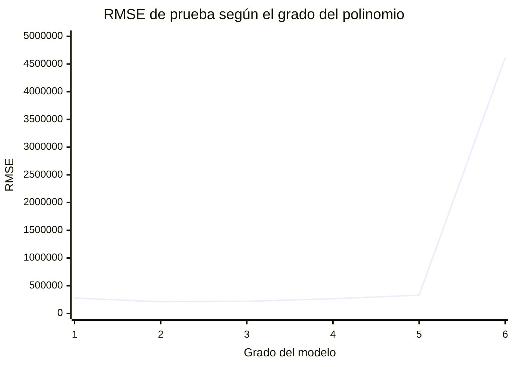
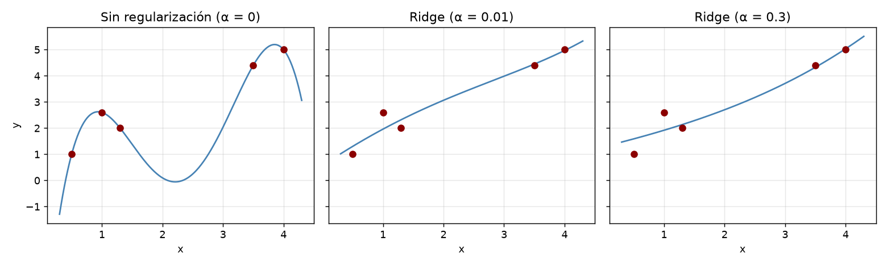
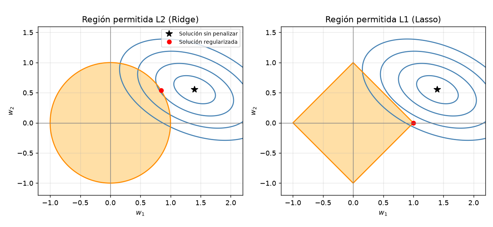
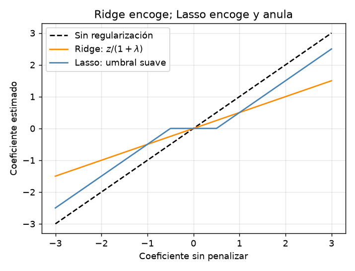
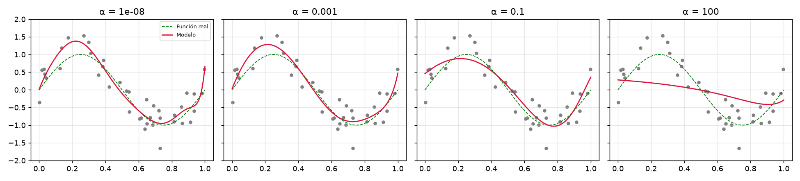
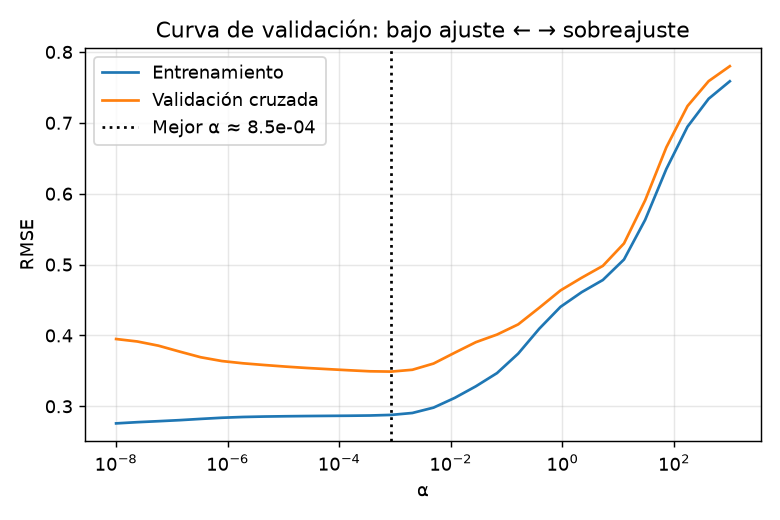
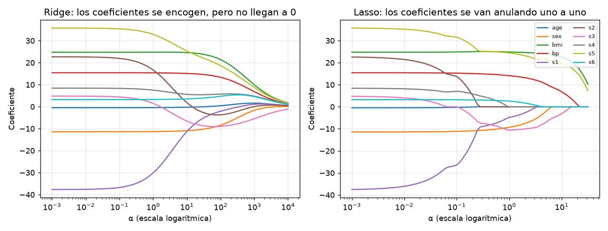
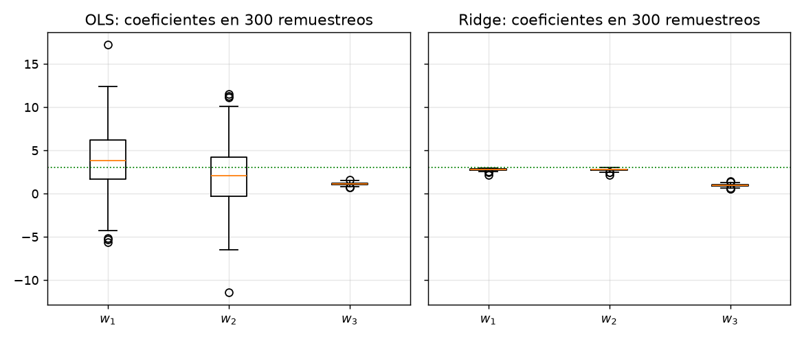
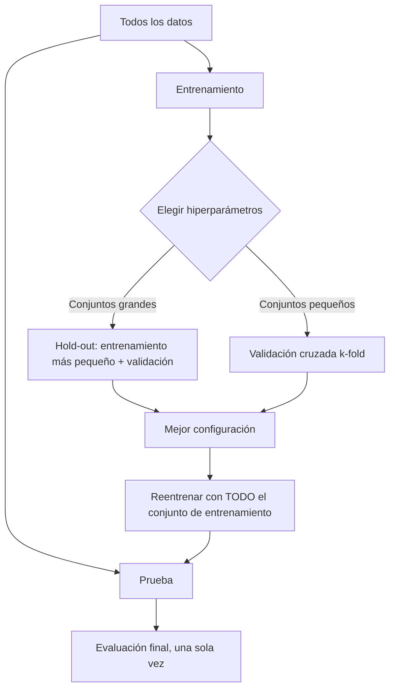

# Regresión polinomial

## Objetivos de aprendizaje

Al terminar estas notas podrás:

- Explicar cómo una regresión lineal puede representar relaciones curvas mediante una transformación polinomial.
- Reconocer el papel de los términos de interacción entre predictores.
- Identificar el efecto del grado sobre la cantidad de parámetros y el riesgo de sobreajuste.
- Construir y evaluar un flujo de trabajo de regresión polinomial con Python y scikit-learn.
- Usar regularización y validación para elegir un modelo que generalice.
- Explicar qué hacen las penalizaciones L2 (Ridge) y L1 (Lasso), cómo se resuelven matemáticamente y cuándo conviene cada una.
- Interpretar el hiperparámetro \(\alpha\) y ajustarlo con validación (hold-out, k-fold, `GridSearchCV`) sin usar el conjunto de prueba.
- Reconocer la multicolinealidad y cómo la regularización estabiliza los coeficientes.

## 1. ¿Cuándo usar regresión polinomial?

La regresión lineal modela la relación entre una variable objetivo \(y\) y uno o más predictores \(x\) como una suma ponderada. Si la relación real es curva, una recta puede resultar demasiado simple. La regresión polinomial permite representar esa curvatura al añadir potencias de los predictores.

Por ejemplo, una relación entre antigüedad de un vehículo y su precio podría disminuir rápidamente al principio y más lentamente después. Una recta no necesariamente captura ese patrón; un polinomio de grado 2 sí puede representar una curva.

> **Idea clave:** la forma de la relación con los datos puede ser no lineal, pero el modelo sigue siendo lineal respecto de sus coeficientes. Por eso se puede estimar con métodos de regresión lineal después de transformar las variables.

### Preguntas orientadoras

- ¿Qué patrón muestran los datos: aproximadamente recto, curvo o con cambios de tendencia?
- ¿Hay suficientes observaciones en todo el rango del predictor para estimar la curva con confianza?
- ¿La curva tiene sentido para el problema de negocio o solo sigue fluctuaciones del conjunto de entrenamiento?

## 2. Cómo funciona la transformación

Con un predictor \(x\), un polinomio de grado \(p\) se expresa como:

\[
\hat{y} = w_0 + w_1x + w_2x^2 + \dots + w_px^p
\]

Para grado 2 se añaden \(x^2\); para grado 3 se añaden \(x^2\) y \(x^3\). Los coeficientes \(w_0,\dots,w_p\) se ajustan a los datos igual que en una regresión lineal.

Con dos predictores \(x_1\) y \(x_2\), una expansión de grado 2 (incluyendo términos de grado menor) produce:

\[
\hat{y} = w_0 + w_1x_1 + w_2x_2 + w_3x_1^2 + w_4x_1x_2 + w_5x_2^2
\]

El término \(x_1x_2\) representa una **interacción**: el efecto de un predictor puede depender del valor del otro. Por ejemplo, el efecto de la antigüedad de un vehículo sobre el precio podría variar según su kilometraje.

La transformación polinomial es una técnica de **ingeniería de características**: crea representaciones nuevas a partir de las variables disponibles para que el modelo pueda aprender patrones más ricos.

### Crecimiento del número de características

Con \(d\) predictores y polinomios de grado máximo \(p\), el número de términos, sin contar el sesgo, es:

\[
\binom{d+p}{p} - 1
\]

Este crecimiento puede ser rápido. Por ello, aumentar el grado incrementa la flexibilidad, pero también el costo computacional y el riesgo de sobreajuste.

### Preguntas orientadoras

- ¿Qué términos nuevos crea una expansión de grado 2 para dos predictores?
- ¿Tiene sentido incluir interacciones para el fenómeno que se quiere explicar?
- ¿Cuántas características tendrá la expansión antes de entrenarla?

## 3. Ejemplo práctico: aproximar una relación curva

El siguiente ejemplo genera datos sintéticos con una tendencia cuadrática y ruido. Compara una recta con un modelo polinomial de grado 2 en un conjunto de prueba.

```python
import numpy as np
from sklearn.linear_model import LinearRegression
from sklearn.metrics import mean_squared_error
from sklearn.model_selection import train_test_split
from sklearn.pipeline import make_pipeline
from sklearn.preprocessing import PolynomialFeatures, StandardScaler

rng = np.random.default_rng(42)
X = np.linspace(-3, 3, 120).reshape(-1, 1)
y = 2 + 1.5 * X[:, 0] + 2 * X[:, 0] ** 2
y += rng.normal(0, 2, size=X.shape[0])

X_train, X_test, y_train, y_test = train_test_split(
    X, y, test_size=0.25, random_state=42
)

modelos = {
    "Lineal": make_pipeline(StandardScaler(), LinearRegression()),
    "Polinomial grado 2": make_pipeline(
        StandardScaler(),
        PolynomialFeatures(degree=2, include_bias=False),
        LinearRegression(),
    ),
}

for nombre, modelo in modelos.items():
    modelo.fit(X_train, y_train)
    predicciones = modelo.predict(X_test)
    rmse = np.sqrt(mean_squared_error(y_test, predicciones))
    print(f"{nombre}: RMSE = {rmse:.2f}")
```

La escala de las variables se ajusta dentro del flujo de trabajo. Así, el escalador se entrena solo con los datos de entrenamiento y no obtiene información del conjunto de prueba. En este ejemplo, la curva cuadrática que generó los datos es un patrón conocido; en un caso real, la forma se debe inferir y validar con datos separados.

Para visualizar los resultados, se puede ordenar el conjunto de prueba y graficar sus valores reales junto con las predicciones:

```python
import matplotlib.pyplot as plt

orden = np.argsort(X_test[:, 0])
modelo = modelos["Polinomial grado 2"]
predicciones = modelo.predict(X_test)

plt.scatter(X_test[:, 0], y_test, label="Datos de prueba", alpha=0.7)
plt.plot(
    X_test[orden, 0],
    predicciones[orden],
    color="crimson",
    label="Predicción polinomial",
)
plt.xlabel("x")
plt.ylabel("y")
plt.title("Ajuste de una regresión polinomial de grado 2")
plt.legend()
plt.tight_layout()
plt.show()
```

## 4. Complejidad, generalización y sobreajuste

La complejidad del modelo aumenta con el número de parámetros que debe aprender. Al incrementar el grado, la curva puede adaptarse mejor a los datos de entrenamiento, pero también puede empezar a seguir el ruido. A esto se le llama **sobreajuste**: el rendimiento en entrenamiento es bueno, pero el modelo predice peor para observaciones nuevas.

Las notas originales incluyen este ejemplo de predicción de ventas de vehículos. La cantidad de variables y el RMSE de prueba reportados muestran que el grado 2 fue el mejor de los grados comparados. Un RMSE menor indica, en promedio, errores de predicción menores, en las mismas unidades de la variable objetivo.

| Modelo | Cantidad de variables reportada | RMSE en prueba |
|---|---:|---:|
| Regresión lineal | 13 | 278 458.18 |
| Polinomial, grado 2 | 105 | 210 850.68 |
| Polinomial, grado 3 | 560 | 218 964.68 |
| Polinomial, grado 4 | 2 380 | 265 285.78 |
| Polinomial, grado 5 | 8 568 | 330 713.33 |
| Polinomial, grado 6 | 27 132 | 4 615 794.01 |



El patrón ilustra el equilibrio entre **sesgo** y **varianza**:

- Un modelo demasiado simple puede no capturar la estructura de los datos (sesgo alto).
- Un modelo demasiado complejo puede aprender ruido y generalizar mal (varianza alta).
- El objetivo es elegir complejidad suficiente para representar el patrón, sin añadir complejidad innecesaria.

Esto se relaciona con la **navaja de Ockham**: entre modelos con desempeño adecuado, conviene preferir el más sencillo. El grado 2 de la tabla obtiene el RMSE de prueba más bajo; los grados mayores no mejoran ese resultado.

> Los valores de la tabla son resultados del ejemplo incluido en las notas fuente; no son una garantía de que esos grados tengan el mismo desempeño en otros datos.

### Preguntas orientadoras

- ¿Qué modelo tiene el menor error en prueba?
- ¿Qué ocurre con el error al pasar de grado 2 a grados mayores?
- Si el error de entrenamiento baja al subir el grado, ¿significa necesariamente que el modelo mejoró?
- ¿Qué consecuencias tendría para el negocio una predicción con un error de ese tamaño?

## 5. Regularización: controlar la complejidad del modelo

### 5.1 ¿Qué es la regularización y por qué la necesitamos?

*Regularizar* significa "determinar las reglas o normas a las que debe ajustarse algo". En aprendizaje automático se usa el mismo concepto: se **imponen restricciones al algoritmo de aprendizaje** para evitar el sobreajuste. Estas restricciones permiten usar modelos complejos (por ejemplo, un polinomio de grado alto) y obtener soluciones simples que generalizan mejor.

Ante un problema de bajo ajuste o de sobreajuste hay varias salidas posibles:

| Problema | Síntoma | Qué se puede hacer |
|---|---|---|
| **Bajo ajuste** (modelo demasiado simple) | Error alto en entrenamiento y en prueba | Incluir más variables representativas; aumentar la complejidad (p. ej., características polinomiales) |
| **Sobreajuste** (modelo demasiado complejo para los datos) | Error bajo en entrenamiento y alto en prueba | Incluir más datos representativos; reducir la complejidad (eliminar variables no informativas); **aplicar técnicas de regularización** |

Una forma de implementar la regularización es **modificar la función de costo** para que el algoritmo, además de ajustar los datos, esté obligado a mantener pequeños (o nulos) los valores de los parámetros.

#### Preguntas orientadoras

- ¿Qué diferencia hay entre "reducir la complejidad eliminando variables" y "regularizar"?
- Si el error de entrenamiento y el de prueba son altos y parecidos, ¿conviene regularizar más o menos?

### 5.2 La función de costo penalizada

Para una regresión lineal con \(N\) observaciones y \(d\) predictores, la función de costo (error cuadrático medio) es:

\[
J(\mathbf{w}) = \frac{1}{N}\sum_{i=1}^{N}\left(\hat{y}_i - y_i\right)^2,
\qquad
\hat{y}_i = w_0 + w_1x_{i1} + \dots + w_dx_{id}
\]

Con regularización se **añade un término de penalización** (o de regularización) que limita los valores que pueden tomar los parámetros:

\[
J_{reg}(\mathbf{w}) = \frac{1}{N}\sum_{i=1}^{N}\left(\hat{y}_i - y_i\right)^2 + \text{penalty}(\mathbf{w})
\]

El algoritmo ahora debe minimizar **dos cosas a la vez**: el error de ajuste y el tamaño de los coeficientes. Es un compromiso (*trade-off*): reducir el error obliga a usar coeficientes grandes; la penalización lo castiga.

> **Convención habitual:** el intercepto \(w_0\) **no se penaliza** (las sumas de penalización empiezan en \(j=1\)). Así la regularización no depende del origen de la variable objetivo.

#### Un ejemplo para visualizarlo

Supongamos que ajustamos cinco puntos con un polinomio de grado 4:

\[
\hat{y} = w_0 + w_1x + w_2x^2 + w_3x^3 + w_4x^4
\]

Con cinco puntos y cinco parámetros, el modelo puede pasar **exactamente** por todos ellos: es un modelo sobreajustado, con oscilaciones entre (y fuera de) los datos. Si se modifica la función de costo para penalizar los coeficientes de los términos de mayor grado, por ejemplo

\[
J_{reg} = \frac{1}{N}\sum_{i}\left(\hat{y}_i - y_i\right)^2 + 400\,(w_3^2 + w_4^2),
\]

el algoritmo prefiere hacer \(w_3 \approx 0\) y \(w_4 \approx 0\), y el modelo se parece a una curva de grado 2: **un modelo complejo que se comporta como uno simple**. Fíjate en que la penalización incluye un parámetro (aquí 400) que controla cuánto se quiere penalizar: es un **hiperparámetro**, que se debe ajustar al conjunto de datos antes de construir el modelo.

El siguiente gráfico reproduce la idea con Ridge sobre cinco puntos (α crece de izquierda a derecha en los dos últimos paneles):



Sin regularización la curva interpola los puntos y oscila; con una penalización moderada se suaviza y con una mayor tiende a una forma más simple.

### 5.3 Ridge (norma L2) y Lasso (norma L1)

Las dos penalizaciones más usadas en la práctica son:

| | Ridge (L2) | Lasso (L1) |
|---|---|---|
| **Penalización** | \(\alpha\sum_{j=1}^{d} w_j^2\) | \(\alpha\sum_{j=1}^{d} \lvert w_j\rvert\) |
| **Función de costo** | \(\frac{1}{N}\sum_i(\hat{y}_i-y_i)^2 + \alpha\sum_j w_j^2\) | \(\frac{1}{N}\sum_i(\hat{y}_i-y_i)^2 + \alpha\sum_j \lvert w_j\rvert\) |
| **Efecto sobre los coeficientes** | Los encoge hacia cero; rara vez los anula | Los encoge y **puede anular** algunos |
| **Selección de variables** | No (conserva todas) | **Sí**: deja solo las variables informativas |
| **Modelo resultante** | Combinación lineal de todas las variables | Combinación lineal de un subconjunto de variables |
| **Clase en scikit-learn** | `Ridge` | `Lasso` |

> **Nota sobre las notas originales:** en una de las diapositivas la fórmula de Lasso aparece con \(\lvert w_j\rvert^2\). La penalización L1 correcta es \(\lvert w_j\rvert\) **sin** elevar al cuadrado; elevarla al cuadrado equivaldría a L2. Además, el ejemplo de grado 4 escribe la penalización como \(400\sum w_j\), sin cuadrado ni valor absoluto: con esa forma, un coeficiente negativo *reduciría* el costo y el algoritmo lo empujaría hacia \(-\infty\). Por eso la penalización debe usar \(w_j^2\) (Ridge) o \(\lvert w_j\rvert\) (Lasso).

#### ¿Por qué Lasso anula coeficientes y Ridge no? La geometría

Minimizar \(J_{reg}\) equivale a minimizar el error cuadrático **dentro de una región permitida** para los coeficientes: un **círculo** (L2) o un **rombo** (L1). Las elipses azules son curvas de nivel del error; la solución regularizada es el primer punto donde una elipse toca la región. El rombo tiene **vértices sobre los ejes**, donde algún \(w_j = 0\); por eso el contacto ocurre ahí con frecuencia. El círculo no tiene esquinas, así que el contacto casi nunca cae exactamente sobre un eje.



#### La misma idea, vista en una dimensión

Para un solo coeficiente, Ridge lo **escala** por un factor constante (\(\hat w/(1+\lambda)\)), mientras que Lasso aplica un **umbral suave**: resta una cantidad fija y, si el coeficiente es menor que ese umbral, lo deja en cero exactamente.



#### Preguntas orientadoras

- ¿Por qué Ridge "conserva todas las variables" aunque sus coeficientes sean pequeños?
- Si tienes 200 variables y sospechas que solo 10 son relevantes, ¿qué penalización probarías primero? ¿Por qué?
- ¿Qué pasa con la interpretación del modelo cuando Lasso deja un coeficiente en cero?

### 5.4 El hiperparámetro α: el control de la complejidad

\(\alpha \ge 0\) regula **cuánta regularización** se aplica y, en consecuencia, la complejidad del modelo final:

- **\(\alpha = 0\):** no hay penalización; se recupera la regresión lineal (o polinomial) ordinaria.
- **\(\alpha\) creciente:** se imponen más restricciones a los coeficientes, lo que reduce el sobreajuste.
- **\(\alpha\) demasiado grande:** los coeficientes se acercan a cero y el modelo se vuelve tan simple que **no capta el patrón (bajo ajuste)**.

Por eso \(\alpha\) debe ajustarse con cuidado, mediante técnicas de validación (sección 5.8), nunca con el conjunto de prueba.

El siguiente ejemplo ajusta un polinomio de **grado 12** a 40 puntos ruidosos de una función seno (verde, discontinua). Se usa Ridge con diferentes valores de \(\alpha\) (con las variables estandarizadas):



- \(\alpha\) casi nulo: la curva oscila en los extremos y sigue el ruido (varianza alta).
- \(\alpha\) intermedio: sigue la forma real del seno.
- \(\alpha\) muy grande: casi una recta (sesgo alto, bajo ajuste).

La **curva de validación** resume el compromiso. El error de entrenamiento solo crece al aumentar \(\alpha\); el error de validación cruzada tiene un mínimo, que indica el mejor \(\alpha\):



En este ejemplo (semilla fija, 5 particiones) el mínimo está en \(\alpha \approx 8.5\times10^{-4}\). Ese valor es específico de estos datos y de la escala de las variables; no es un valor "recomendado" general.

#### Caminos de regularización

Una forma muy informativa de ver el efecto de \(\alpha\) es graficar cada coeficiente en función de \(\alpha\). Con el conjunto *diabetes* de scikit-learn (442 pacientes, 10 variables estandarizadas; ver Efron et al., 2004):



- En **Ridge** todas las curvas se aproximan suavemente a cero, pero no lo alcanzan.
- En **Lasso** los coeficientes se van haciendo **exactamente cero**, uno tras otro, a medida que aumenta \(\alpha\). El orden en que sobreviven indica qué variables son más informativas (aquí `bmi`, `s5` y `bp` son las últimas en anularse).

#### Preguntas orientadoras

- ¿Qué esperas que ocurra con el error de entrenamiento al aumentar \(\alpha\)? ¿Y con el de validación?
- ¿Por qué el mejor \(\alpha\) depende de la escala de las variables?
- ¿Qué indicaría un modelo con un error de entrenamiento muy alto aun con \(\alpha\) pequeño?

### 5.5 ¿Cómo se resuelve matemáticamente? (y cómo programarlo)

Las notas originales dejan esta pregunta abierta: *¿cómo se soluciona matemáticamente este algoritmo?* La clave es que **la regularización solo cambia la función de costo**; el modelo sigue siendo una combinación lineal de las variables. Cambia, eso sí, cómo se encuentran los coeficientes.

Notación matricial (con \(X\) y \(y\) **centrados**, para que el intercepto quede fuera de la penalización).

#### Ridge: solución cerrada

Se minimiza

\[
J(\mathbf{w}) = \lVert \mathbf{y} - X\mathbf{w}\rVert_2^2 + \alpha\lVert\mathbf{w}\rVert_2^2 .
\]

Como \(J\) es derivable y convexa, basta con igualar el gradiente a cero:

\[
\nabla J = -2X^\top(\mathbf{y}-X\mathbf{w}) + 2\alpha\mathbf{w} = 0
\;\Longrightarrow\;
\hat{\mathbf{w}}_{ridge} = \left(X^\top X + \alpha I\right)^{-1}X^\top\mathbf{y}.
\]

Observaciones importantes:

- Con \(\alpha=0\) se obtiene la solución de mínimos cuadrados \((X^\top X)^{-1}X^\top\mathbf{y}\).
- Para \(\alpha>0\), la matriz \(X^\top X+\alpha I\) **siempre es invertible**, aun cuando las variables sean colineales y \(X^\top X\) sea casi singular. Ese es el mecanismo matemático por el que Ridge estabiliza los coeficientes ante la multicolinealidad (sección 5.6).
- Al sumar \(\alpha\) a la diagonal, se "encogen" los coeficientes en las direcciones de poca varianza de los datos.

#### Lasso: no hay solución cerrada

Se minimiza (esta es la forma que usa scikit-learn)

\[
J(\mathbf{w}) = \frac{1}{2N}\lVert \mathbf{y} - X\mathbf{w}\rVert_2^2 + \alpha\lVert\mathbf{w}\rVert_1 .
\]

El valor absoluto **no es derivable en 0**, de modo que no se puede despejar \(\mathbf{w}\) igualando el gradiente a cero. El problema sigue siendo convexo y se resuelve con métodos iterativos. El más usado (scikit-learn lo implementa) es el **descenso de coordenadas**: se optimiza un coeficiente a la vez, manteniendo los demás fijos. Para el coeficiente \(j\), con el residuo parcial \(\mathbf{r}_j = \mathbf{y} - \sum_{k\ne j}\mathbf{x}_k w_k\), la actualización es:

\[
w_j \leftarrow \frac{S\!\left(\mathbf{x}_j^\top \mathbf{r}_j,\; N\alpha\right)}{\mathbf{x}_j^\top\mathbf{x}_j},
\qquad
S(\rho,\lambda) = \operatorname{sign}(\rho)\max(\lvert\rho\rvert-\lambda,\,0)
\]

\(S\) es el **operador de umbral suave** (*soft-thresholding*) de la figura anterior: si la correlación del predictor con el residuo es menor que el umbral \(N\alpha\), el coeficiente se hace exactamente cero. Otros métodos equivalentes: LARS, ISTA/FISTA y subgradiente.

#### Implementación desde cero y verificación

```python
import numpy as np
from sklearn.datasets import load_diabetes
from sklearn.linear_model import Lasso, Ridge
from sklearn.preprocessing import StandardScaler


def ridge_cerrado(X, y, alpha):
    """Ridge con intercepto sin penalizar: w = (XᵀX + αI)⁻¹ Xᵀy sobre datos centrados."""
    mx, my = X.mean(axis=0), y.mean()
    Xc, yc = X - mx, y - my
    w = np.linalg.solve(Xc.T @ Xc + alpha * np.eye(X.shape[1]), Xc.T @ yc)
    return my - mx @ w, w


def umbral_suave(rho, lam):
    return np.sign(rho) * np.maximum(np.abs(rho) - lam, 0.0)


def lasso_cd(X, y, alpha, iteraciones=2000, tol=1e-10):
    """Lasso por descenso de coordenadas: 1/(2N)·||y - b - Xw||² + α·||w||₁."""
    n, d = X.shape
    mx, my = X.mean(axis=0), y.mean()
    Xc, yc = X - mx, y - my
    w = np.zeros(d)
    z = (Xc ** 2).sum(axis=0)
    for _ in range(iteraciones):
        w_anterior = w.copy()
        for j in range(d):
            r_j = yc - Xc @ w + Xc[:, j] * w[j]  # residuo sin la variable j
            w[j] = umbral_suave(Xc[:, j] @ r_j, n * alpha) / z[j]
        if np.max(np.abs(w - w_anterior)) < tol:
            break
    return my - mx @ w, w


datos = load_diabetes()
X = StandardScaler().fit_transform(datos.data)
y = datos.target

_, w_ridge = ridge_cerrado(X, y, alpha=10.0)
_, w_lasso = lasso_cd(X, y, alpha=1.0)

print(np.abs(w_ridge - Ridge(alpha=10.0).fit(X, y).coef_).max())
print(np.abs(w_lasso - Lasso(alpha=1.0, tol=1e-12, max_iter=100_000).fit(X, y).coef_).max())
```

Al ejecutarlo, la diferencia máxima entre los coeficientes propios y los de scikit-learn es del orden de \(10^{-14}\) (Ridge) y \(10^{-11}\) (Lasso): las implementaciones coinciden. Con \(\alpha=1\), Lasso deja en **cero** a `age`, `s2` y `s4`, y conserva el resto (`bmi`, `s5` y `bp` con los coeficientes más grandes).

> **Equivalencia de escalas de \(\alpha\):** la función de costo de las diapositivas usa \(\frac{1}{N}\sum(\cdot)^2\), mientras que scikit-learn usa \(\lVert y-Xw\rVert^2\) en Ridge y \(\frac{1}{2N}\lVert y-Xw\rVert^2\) en Lasso. Los valores de \(\alpha\) no son directamente comparables: \(\alpha_{sk}=N\,\alpha_{diapositiva}\) en Ridge y \(\alpha_{sk}=\alpha_{diapositiva}/2\) en Lasso. Lo importante es usar siempre la misma convención y elegir \(\alpha\) por validación.

> **Lectura bayesiana (opcional):** Ridge equivale a suponer una distribución a priori normal para los coeficientes, y Lasso, una distribución de Laplace (con más masa cerca de cero), lo que explica por qué favorece soluciones "dispersas".

#### Preguntas orientadoras

- ¿Por qué \(X^\top X + \alpha I\) es invertible aunque dos columnas de \(X\) sean iguales?
- ¿Qué ocurre con \(S(\rho,\lambda)\) cuando \(\lambda\) crece? ¿Y cuando \(\lambda = 0\)?
- ¿Qué costo computacional tendría la solución cerrada de Ridge con 50 000 variables? ¿Qué alternativa existe?

### 5.6 Multicolinealidad y regresión regularizada

La **multicolinealidad** aparece cuando las variables de entrada están correlacionadas entre sí. En regresión lineal, esto hace que los coeficientes estimados sean **inestables** (cambian mucho con pequeñas variaciones de los datos) y dificulta su interpretación. Es un problema frecuente al generar características polinomiales: \(x\), \(x^2\) y \(x^3\) suelen estar muy correlacionadas.

Maneras de mitigar el riesgo:

1. **Selección de variables** en la preparación de datos, a partir de un análisis de correlación o del **Factor de Inflación de la Varianza (FIV/VIF)**:

   \[
   \text{VIF}_j = \frac{1}{1-R_j^2}
   \]

   donde \(R_j^2\) es el coeficiente de determinación de regresar la variable \(j\) sobre las demás. Una regla práctica habitual: VIF > 5–10 indica colinealidad preocupante.
2. **Regresión regularizada** (L1 o L2), que produce coeficientes más robustos.

#### Ejemplo

Se generan dos variables casi idénticas, \(x_2 = x_1 + \text{ruido pequeño}\) (correlación 0.999, VIF ≈ 438) y una tercera independiente. La variable objetivo es \(y = 3x_1 + 3x_2 + 1x_3 + \varepsilon\). Se reajusta el modelo con 300 remuestreos *bootstrap* de las 60 observaciones:



| Modelo | Media \(\hat w_1\) | Desv. \(\hat w_1\) | Media \(\hat w_2\) | Desv. \(\hat w_2\) |
|---|---:|---:|---:|---:|
| Mínimos cuadrados | 3.91 | **3.50** | 1.95 | **3.52** |
| Ridge (α = 5) | 2.77 | **0.09** | 2.74 | **0.10** |

Mínimos cuadrados reparte el efecto de forma arbitraria entre \(x_1\) y \(x_2\) (los coeficientes varían entre valores negativos y mayores de 10). Ridge pierde un poco de exactitud (sesgo: ~2.75 en lugar de 3) a cambio de una **varianza mucho menor**: es el compromiso sesgo-varianza en acción.

#### Preguntas orientadoras

- ¿Por qué los coeficientes de OLS pueden tener signos incoherentes cuando hay multicolinealidad, aunque las predicciones sigan siendo razonables?
- ¿Cuándo preferirías eliminar una variable correlacionada y cuándo regularizar?
- Si usas Lasso con dos variables casi idénticas, ¿qué esperas que haga?

### 5.7 Elastic Net: combinar L1 y L2

Cuando hay grupos de variables muy correlacionadas, Lasso tiende a elegir una y descartar arbitrariamente las demás. **Elastic Net** combina ambas penalizaciones:

\[
J(\mathbf{w}) = \frac{1}{2N}\lVert \mathbf{y} - X\mathbf{w}\rVert_2^2
+ \alpha\rho\lVert\mathbf{w}\rVert_1
+ \frac{\alpha(1-\rho)}{2}\lVert\mathbf{w}\rVert_2^2
\]

donde `l1_ratio` (\(\rho\)) controla la mezcla: \(\rho=1\) es Lasso y \(\rho\to 0\) se acerca a Ridge. En scikit-learn: `ElasticNet` o `ElasticNetCV`. Géron (2019, cap. 4) lo prefiere en general sobre Lasso puro, porque este puede comportarse de forma errática cuando hay más variables que observaciones o varias variables fuertemente correlacionadas.

### 5.8 Selección de hiperparámetros: la validación

Los algoritmos tienen **parámetros** (los coeficientes, que aprende el algoritmo) e **hiperparámetros** (grado del polinomio, \(\alpha\), `l1_ratio`; los fija quien modela y controlan la complejidad). Para escoger los hiperparámetros **no se puede usar el conjunto de prueba**: este solo se usa al final, para medir el rendimiento de generalización del modelo definitivo.



#### Opción A: conjunto de validación (hold-out)

Se divide el conjunto de entrenamiento en dos: uno para construir el modelo con una configuración concreta de hiperparámetros y otro para verificar su rendimiento. Se repite con diferentes valores y se elige el mejor. Es adecuada para conjuntos de datos **grandes**.

Ejemplo del caso de venta de vehículos (notas originales): con 15 % de los datos de entrenamiento como validación y MAE como métrica, se compararon \(\alpha \in \{1, 2, 5\}\) con Ridge. El menor MAE se obtuvo con \(\alpha=1\); ese valor se usó para reentrenar con **todo** el entrenamiento y se evaluó en prueba, con mejor generalización que el modelo inicial con \(\alpha=2\).

```python
from sklearn.linear_model import Ridge
from sklearn.metrics import mean_absolute_error
from sklearn.model_selection import train_test_split
from sklearn.pipeline import make_pipeline
from sklearn.preprocessing import StandardScaler

X_ent, X_val, y_ent, y_val = train_test_split(
    X_train, y_train, test_size=0.15, random_state=0
)

resultados = {}
for alpha in [1, 2, 5]:
    modelo = make_pipeline(StandardScaler(), Ridge(alpha=alpha)).fit(X_ent, y_ent)
    resultados[alpha] = mean_absolute_error(y_val, modelo.predict(X_val))

mejor_alpha = min(resultados, key=resultados.get)
modelo_final = make_pipeline(StandardScaler(), Ridge(alpha=mejor_alpha)).fit(X_train, y_train)
```

#### Opción B: validación cruzada de k particiones (*k-fold*)

El conjunto de entrenamiento se divide en \(k\) partes disjuntas. Para cada \(i = 1,\dots,k\): se entrena con las otras \(k-1\) partes, se mide la métrica \(me_i\) en la parte \(i\) y, al final, se promedia:

\[
ME_{final} = \frac{1}{k}\sum_{i=1}^{k} me_i
\]

El proceso se repite para cada valor de hiperparámetro y se elige el de mejor promedio. Es útil para conjuntos **pequeños**, porque aprovecha todos los datos para entrenar y validar. Entrena el modelo \(k\) veces por configuración; es más costoso, pero produce una estimación más estable.

#### GridSearchCV: automatizar la búsqueda

`GridSearchCV` recorre una grilla de valores usando validación cruzada y devuelve el mejor modelo ya reentrenado con todo el conjunto de entrenamiento. Detalles que conviene recordar (de las notas):

- Por defecto **maximiza** la métrica (usa \(R^2\) en regresión). Para errores como MAE o RMSE hay que indicar la versión negativa: `scoring="neg_mean_absolute_error"`, `"neg_root_mean_squared_error"`.
- `KFold(n_splits=10, shuffle=True, random_state=0)` fija las particiones y las hace reproducibles; la división se hace al llamar a `fit`.
- `n_jobs=-1` usa todos los núcleos del procesador.
- Los resultados están en `best_params_`, `best_score_`, `best_estimator_` y `cv_results_`.

#### Ejemplo: seleccionar grado e intensidad con validación cruzada

Este flujo compara varios grados e intensidades de Ridge. La transformación, el escalado y el modelo se encuentran dentro del `Pipeline`, para que cada partición de validación ajuste sus transformaciones exclusivamente con la parte de entrenamiento de esa partición.

```python
from sklearn.linear_model import Ridge
from sklearn.model_selection import GridSearchCV, KFold
from sklearn.pipeline import make_pipeline
from sklearn.preprocessing import PolynomialFeatures, StandardScaler

pipeline = make_pipeline(
    StandardScaler(),
    PolynomialFeatures(include_bias=False),
    StandardScaler(),
    Ridge(),
)

busqueda = GridSearchCV(
    estimator=pipeline,
    param_grid={
        "polynomialfeatures__degree": [1, 2, 3, 4],
        "ridge__alpha": [0.01, 0.1, 1.0, 10.0, 100.0],
    },
    scoring="neg_root_mean_squared_error",
    cv=KFold(n_splits=5, shuffle=True, random_state=42),
    n_jobs=-1,
)

busqueda.fit(X_train, y_train)
mejor_modelo = busqueda.best_estimator_
predicciones_test = mejor_modelo.predict(X_test)
rmse_test = np.sqrt(mean_squared_error(y_test, predicciones_test))

print("Mejores hiperparámetros:", busqueda.best_params_)
print(f"RMSE en prueba: {rmse_test:.2f}")
```

El conjunto de prueba se reserva para la evaluación final; no se debe usar para escoger el grado ni `alpha`. Para datos ordenados en el tiempo, se debe utilizar una estrategia de validación que respete el orden temporal en lugar de mezclar observaciones al azar (por ejemplo, `TimeSeriesSplit`).

#### Preguntas orientadoras

- ¿Qué problema intenta reducir la regularización?
- ¿Por qué no se debe seleccionar `alpha` mirando el resultado del conjunto de prueba?
- ¿Cuándo preferirías un conjunto de validación y cuándo validación cruzada?
- ¿Por qué `GridSearchCV` necesita `neg_mean_absolute_error` y no simplemente `mean_absolute_error`?
- ¿La validación cruzada usada representa adecuadamente cómo llegarán los datos futuros?

### 5.9 Caso práctico: Lasso como selector de variables

En el caso de venta de vehículos de las notas, se usó `GridSearchCV` con `KFold(k=10)` y \(\alpha \in \{1,2,3,4,5\}\); el mejor resultado fue \(\alpha=5\) (también al puntuar con MAE). Al revisar los coeficientes del mejor modelo, las variables `combustible_CNG` y `segundo propietario` quedaron en **cero**: no aportan a explicar el precio, una vez consideradas las demás. El resto tiene coeficiente distinto de cero y se consideran informativas.

```python
from sklearn.linear_model import Lasso
from sklearn.model_selection import GridSearchCV, KFold
from sklearn.pipeline import make_pipeline
from sklearn.preprocessing import StandardScaler
import pandas as pd

busqueda = GridSearchCV(
    make_pipeline(StandardScaler(), Lasso(max_iter=50_000)),
    param_grid={"lasso__alpha": [1, 2, 3, 4, 5]},
    scoring="neg_mean_absolute_error",
    cv=KFold(n_splits=10, shuffle=True, random_state=0),
    n_jobs=-1,
).fit(X_train, y_train)

coeficientes = pd.Series(
    busqueda.best_estimator_[-1].coef_, index=X_train.columns
).sort_values(key=abs, ascending=False)

print(coeficientes)                           # importancia relativa
print("Variables descartadas:", list(coeficientes[coeficientes == 0].index))
```

> **Cuidado con el código de las notas:** los videos usan `Ridge(alpha=..., normalize=True)`. El parámetro `normalize` fue **eliminado** en scikit-learn 1.2. Hoy se estandariza con `StandardScaler` (idealmente dentro de un `Pipeline`, como arriba). Además, para comparar la magnitud de los coeficientes es imprescindible que las variables estén en la misma escala.

### 5.10 Polinomial + regularización: un ejemplo reproducible

El conjunto *diabetes* (442 observaciones, 10 variables) permite ver la combinación completa. Al expandir a grado 2 se pasa de 10 a **65 características**. Se evalúa cada modelo con validación cruzada externa de 5 particiones; Ridge y Lasso eligen su \(\alpha\) con validación cruzada interna (`RidgeCV`, `LassoCV`):

```python
from sklearn.datasets import load_diabetes
from sklearn.linear_model import LassoCV, LinearRegression, RidgeCV
from sklearn.model_selection import KFold, cross_val_score
from sklearn.pipeline import make_pipeline
from sklearn.preprocessing import PolynomialFeatures, StandardScaler
import numpy as np

X, y = load_diabetes(return_X_y=True)


def pipe(estimador, grado):
    return make_pipeline(
        PolynomialFeatures(grado, include_bias=False), StandardScaler(), estimador
    )


modelos = {
    "Lineal (grado 1)": pipe(LinearRegression(), 1),
    "Polinomial g=2, sin regularizar": pipe(LinearRegression(), 2),
    "Polinomial g=2 + Ridge": pipe(RidgeCV(alphas=np.logspace(-3, 3, 60)), 2),
    "Polinomial g=2 + Lasso": pipe(LassoCV(alphas=np.logspace(-1, 1.7, 40), cv=5, max_iter=20_000), 2),
}

cv = KFold(5, shuffle=True, random_state=42)
for nombre, modelo in modelos.items():
    rmse = -cross_val_score(modelo, X, y, cv=cv, scoring="neg_root_mean_squared_error")
    print(f"{nombre}: {rmse.mean():.2f} ± {rmse.std():.2f}")
```

| Modelo | RMSE medio (± desv.) |
|---|---:|
| Lineal (grado 1) | 54.85 ± 2.64 |
| Polinomial grado 2, sin regularizar (65 variables) | 60.60 ± 4.48 |
| Polinomial grado 2 + Ridge | 55.71 ± 2.18 |
| Polinomial grado 2 + Lasso | **54.60** ± 2.76 |

Lectura de los resultados:

- La expansión polinomial **sin regularizar empeora** el error (60.60) y lo hace más variable: sobreajuste.
- Ridge y Lasso **recuperan** el rendimiento aunque el modelo tenga 65 variables. Lasso, además, conserva solo 16 de las 65 características (cuando se ajusta con todos los datos).
- Las diferencias entre lineal, Ridge y Lasso son menores que la desviación entre particiones: en este conjunto **no hay evidencia de que la expansión polinomial mejore** al modelo lineal. La regularización permite "pagar" la flexibilidad sin penalizar el error, pero no garantiza una mejora.

> Estos valores son resultados de una ejecución concreta (semilla 42); pueden variar ligeramente con otras versiones de scikit-learn.

El código que genera todas las figuras y los números de esta sección está en [generar_figuras_regularizacion.py](generar_figuras_regularizacion.py).

### 5.11 Errores comunes al regularizar

| Error | Consecuencia | Cómo evitarlo |
|---|---|---|
| No estandarizar las variables | La penalización castiga más a las variables con escala pequeña; \(\alpha\) deja de ser comparable | `StandardScaler` dentro del `Pipeline` |
| Escoger \(\alpha\) con el conjunto de prueba | Estimación optimista del rendimiento (fuga de información) | Validación cruzada solo sobre entrenamiento |
| Penalizar el intercepto | Sesgo en las predicciones | Usar las implementaciones de scikit-learn (no lo penalizan) |
| Grilla de \(\alpha\) en escala lineal y muy estrecha | El mejor valor queda en el borde de la grilla | Usar escala logarítmica (`np.logspace`) y revisar que el óptimo no esté en un extremo |
| Interpretar coeficientes de Lasso como "causales" | Conclusiones erróneas: con variables correlacionadas Lasso elige una al azar | Usar Elastic Net o validar la estabilidad de la selección |
| Esperar que regularizar arregle datos de mala calidad | Mismo problema, con otro modelo | Revisar la preparación de datos y la métrica |
| Mucha regularización | Bajo ajuste | Mirar la curva de validación |

### 5.12 Ejercicio de práctica (caso de venta de inmuebles)

Con los datos de `venta_inmuebles_data.xlsx` y los *notebooks* [Ridge.ipynb](Ridge.ipynb) y [Lasso.ipynb](Lasso.ipynb):

1. Prepara los datos según las características del conjunto (módulo 1) y separa entrenamiento y prueba.
2. Entrena **Ridge** con `GridSearchCV` para \(\alpha \in \{0.1, 0.25, 0.5\}\); evalúa el mejor modelo en prueba.
3. Repite con **Lasso** y los mismos valores de \(\alpha\).
4. Construye una tabla comparativa con las métricas de prueba de: regresión lineal, Ridge y Lasso.
5. Responde: ¿hay diferencias entre las métricas? ¿Cuál generaliza mejor? En Lasso, ¿qué variables quedaron en el modelo (coeficiente ≠ 0)?
6. Relaciona cada sección del *notebook* con una etapa de la metodología **ASUM-DM** (comprensión del negocio, comprensión de los datos, preparación de los datos, modelado, evaluación, despliegue).

Plantilla para la tabla comparativa:

| Modelo | α elegido | RMSE (prueba) | MAE (prueba) | \(R^2\) (prueba) | Variables con coeficiente 0 |
|---|---:|---:|---:|---:|---|
| Regresión lineal | — | | | | — |
| Ridge | | | | | — |
| Lasso | | | | | |

#### Preguntas de autoevaluación

<details>
<summary>1. Un modelo polinomial de grado 8 tiene RMSE de entrenamiento 0.5 y RMSE de validación 3.2. ¿Qué hipótesis plantearías y qué harías?</summary>

Hay una gran brecha entre entrenamiento y validación: sobreajuste. Se puede aumentar \(\alpha\) (Ridge/Lasso), reducir el grado, conseguir más datos o eliminar variables no informativas, siempre comparando con validación cruzada.
</details>

<details>
<summary>2. Con \(\alpha\) = 0 en Ridge, ¿qué modelo se obtiene? ¿Y si \(\alpha\to\infty\)?</summary>

Con \(\alpha=0\) se recupera la regresión lineal por mínimos cuadrados. Con \(\alpha\to\infty\) todos los coeficientes (salvo el intercepto) tienden a cero y el modelo predice aproximadamente la media de \(y\).
</details>

<details>
<summary>3. ¿Por qué Lasso se considera también un método de selección de variables?</summary>

Porque la penalización L1 puede llevar coeficientes exactamente a cero; las variables con coeficiente cero quedan fuera de la combinación lineal.
</details>

<details>
<summary>4. ¿Por qué se reentrena el mejor modelo con todo el conjunto de entrenamiento antes de evaluar en prueba?</summary>

Porque, una vez elegidos los hiperparámetros, el modelo definitivo puede aprovechar todos los datos de entrenamiento; la prueba sigue sin usarse hasta la evaluación final.
</details>

## 6. Métricas y procedimiento recomendado

Un proceso de trabajo fiable puede seguir estos pasos:

1. **Explorar los datos:** revisar distribuciones, valores atípicos, relaciones y unidades.
2. **Separar entrenamiento y prueba:** hacerlo antes de ajustar transformaciones o modelos.
3. **Definir una referencia:** comparar con una regresión lineal simple u otro modelo base.
4. **Construir el flujo de trabajo:** incluir transformación polinomial, escalado y regresión en un `Pipeline`.
5. **Seleccionar hiperparámetros:** usar validación cruzada solo con los datos de entrenamiento.
6. **Evaluar una sola vez en prueba:** reportar métricas en unidades comprensibles para el problema.
7. **Revisar residuos y límites de uso:** buscar patrones sistemáticos y evitar extrapolaciones no justificadas.

Métricas comunes:

- **RMSE:** raíz del error cuadrático medio. Penaliza con fuerza los errores grandes y conserva las unidades de \(y\).
- **MAE:** error absoluto medio. Es menos sensible a errores extremos que RMSE.
- **\(R^2\):** proporción de variabilidad explicada respecto de una referencia; no reemplaza la interpretación del error en unidades del negocio.

La evaluación debe considerar más de una métrica cuando sea necesario. Un buen valor promedio no garantiza que los errores sean aceptables para todos los grupos o rangos de predicción.

## 7. Límites y buenas prácticas

- No asumir que un grado alto es mejor: validar su desempeño con datos no usados en el ajuste.
- Evitar extrapolar lejos del rango observado. Los polinomios pueden crecer rápidamente en los extremos.
- Escalar las características, especialmente cuando se usan grados altos o regularización.
- Usar `include_bias=False` cuando el estimador ya aprende un intercepto.
- Evitar calcular potencias manualmente antes de separar entrenamiento y prueba; preferir un `Pipeline`.
- Con varios predictores, controlar la expansión de características y considerar selección de variables, Ridge, Lasso o Elastic Net (sección 5).
- Verificar que las interacciones generadas tengan sentido y sean posibles de explicar en el contexto.
- Ajustar \(\alpha\) en escala logarítmica y comprobar que el valor elegido no quede en el borde de la grilla.

## 8. Síntesis

La regresión polinomial amplía la regresión lineal mediante potencias e interacciones de las variables predictoras. El ajuste sigue siendo lineal respecto de los coeficientes, pero el espacio de características puede crecer rápidamente. Un grado mayor puede capturar patrones más complejos, aunque también aumentar el sobreajuste. La validación cruzada, la regularización, el escalado y una evaluación final separada ayudan a elegir un modelo útil y con capacidad de generalización.

La regularización modifica la función de costo con un término de penalización: Ridge (L2) encoge los coeficientes y estabiliza el modelo ante la multicolinealidad; Lasso (L1) además anula coeficientes y actúa como selector de variables; Elastic Net combina ambos. El modelo conserva su estructura lineal en los coeficientes; solo cambia la forma de encontrarlos (solución cerrada en Ridge, métodos iterativos como el descenso de coordenadas en Lasso). El hiperparámetro \(\alpha\) controla el equilibrio entre sesgo y varianza y debe ajustarse con validación, no con el conjunto de prueba.

## Bibliografía

- Kuhn, M. y Johnson, K. (2020). *Feature Engineering and Selection: A Practical Approach for Predictive Models*. CRC Press.
- Zheng, A. y Casari, A. (2018). *Feature Engineering for Machine Learning*. O'Reilly Media.
- Müller, A. C. y Guido, S. (2016). *Introduction to Machine Learning with Python: A Guide for Data Scientists*. O'Reilly Media.
- scikit-learn. *PolynomialFeatures*. https://scikit-learn.org/stable/modules/generated/sklearn.preprocessing.PolynomialFeatures.html
- scikit-learn. *Pipelines and composite estimators*. https://scikit-learn.org/stable/modules/compose.html
- scikit-learn. *Linear models: Ridge regression and Lasso*. https://scikit-learn.org/stable/modules/linear_model.html
- Géron, A. (2019). *Hands-On Machine Learning with Scikit-Learn, Keras, and TensorFlow*. O'Reilly Media. Cap. 4, "Regularized Linear Models", pp. 136-142.
- Hastie, T., Tibshirani, R. y Friedman, J. (2009). *The Elements of Statistical Learning* (2.ª ed.), cap. 3. https://hastie.su.domains/ElemStatLearn/
- James, G., Witten, D., Hastie, T. y Tibshirani, R. (2021). *An Introduction to Statistical Learning* (2.ª ed.), cap. 6. https://www.statlearning.com/
- Hoerl, A. E. y Kennard, R. W. (1970). Ridge regression: biased estimation for nonorthogonal problems. *Technometrics*, 12(1), 55-67.
- Tibshirani, R. (1996). Regression shrinkage and selection via the Lasso. *Journal of the Royal Statistical Society B*, 58(1), 267-288.
- Efron, B., Hastie, T., Johnstone, I. y Tibshirani, R. (2004). Least angle regression. *Annals of Statistics*, 32(2), 407-499 (origen del conjunto *diabetes*).
- scikit-learn. *Ridge*, *Lasso*, *ElasticNet*: https://scikit-learn.org/stable/modules/generated/sklearn.linear_model.Ridge.html, https://scikit-learn.org/stable/modules/generated/sklearn.linear_model.Lasso.html, https://scikit-learn.org/stable/modules/generated/sklearn.linear_model.ElasticNet.html
- scikit-learn. *Plot Ridge coefficients as a function of the regularization*. https://scikit-learn.org/stable/auto_examples/linear_model/plot_ridge_path.html
- scikit-learn. *Ordinary Least Squares and Ridge Regression Variance*. https://scikit-learn.org/stable/auto_examples/linear_model/plot_ols_ridge_variance.html
- scikit-learn. *Underfitting vs. Overfitting*. https://scikit-learn.org/stable/auto_examples/model_selection/plot_underfitting_overfitting.html
- scikit-learn. *Cross-validation: evaluating estimator performance* y *GridSearchCV*. https://scikit-learn.org/stable/modules/cross_validation.html, https://scikit-learn.org/stable/modules/generated/sklearn.model_selection.GridSearchCV.html